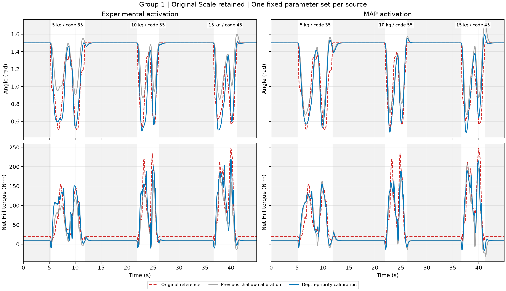

# Exoskeleton Musculoskeletal Modeling and NMPC

**Current MATLAB demos:** open [Demo](Demo/README.md). For the latest 528
model, run `run_dual_MTU_BSE` from `Demo/BSE/Direct_Activation_No_Limits`.
For the current PID/NMPC comparison, run `offline_PID_NMPC_comparison_528`
from `Demo/NMPC`. Both demos load the same calibrated two-MTU BSE.
See [local input setup](Demo/README.md#local-inputs) before running from a fresh checkout. Figures, comments and instructions
are in English. NMPC requires Optimization Toolbox and a configured C compiler.
Neither Python nor Simulink is required. The older model descriptions below
refer to retained historical revisions.

**528 / 725 / 730 nine-condition BSE and 75%-peak NMPC:** run
`demo_nine_case_75pct` to view the current comparison, including abdominal and
soft-boundary torques. Each subject/source has one fixed BSE vector; each
subject has its own controller tuning. The dashed limit is 75% of the
corresponding unassisted back-muscle peak. See the
[method and result guide](docs/NINE_CASES_75PCT.zh-CN.md), including retained
discrepancies and reproduction instructions. Historical results follow.

**725 speed-grid BSE:** After auditing 5/10/15 kg at speed codes 25--65,
five actions without CEINMS torque support are excluded entirely. Ten actions
remain for joint calibration, with priority on six available 35--55 cases.
`demo_725_bse_speed_grid` shows both activation sources, theta, muscle torques
and soft-boundary torque including standing waits. MAP remains frozen;
NMPC has not been retuned for this model. [Method](docs/EXP_SPEED_GRID.zh-CN.md)
and [quantitative results](docs/exp_speed_grid/summary.zh-CN.md).

**Previous Exp three-load workflow:** MAP uses excitation; BSE/NMPC scenarios are limited
to **5/10/15 kg**. The 725 fit uses three complete excitation/IK anchors and masks
missing torque references. Completed 617/627/730 models and MAPs are preserved.
Use `demo_exp_subjects`, `('status')`, or `('run')` to view, inspect, or finish
missing stages. Its 725 MPC plots use the previous BSE model.
[Previous method and limits](docs/EXP_THREE_LOADS.zh-CN.md).

**CEINMS torque-reference audit:** `demo_ceinms_reference_audit` compares native
exports, A=0.1 estimates and passive torque. All 54 checked records follow an
active-only equivalent rule. No independent torque/force target is available;
the candidates are not calibrated ground truth.
[Method and limitations](docs/CEINMS_REFERENCE_AUDIT.zh-CN.md).

Derived datasets are also saved beside the originals as `Data/240725Exp_A01`
and `Data/240730Exp_A01` (25 and 29 records). Their default `Torque.sto` is an
uncalibrated model estimate; original outputs are archived separately.

**Exp activation update: both groups now have a separate A = +0.1 input profile.**
Run `demo_exp_activation_A01` to compare back/abdomen activation and all 25/23
retained conditions. This recomputes activation; it does not retrain BSE/MAP/MPC.
[Results and reproduction](docs/EXP_ACTIVATION_A01.zh-CN.md).

**Latest Exp review: one complete M pair per condition.** With existing IK
accepted by the user, 240725Exp retains 25/25 and 240730Exp 23/25 candidate
conditions. Run `demo_exp_data_review`; these are data reviews, not new Exp
BSE/MPC fits. [Decisions and remaining issues](docs/EXP_ONE_CYCLE_REVIEW.zh-CN.md).
The current optimized implementation uses a MATLAB entry point, Python
training/MPC, and a C physical solver; the `.slx` files retain the original
implementation. [Runtime guide](docs/PROJECT_RUNTIME.zh-CN.md).

**New Exp audit (2026-10-20):** 240725Exp / 240730Exp both have all five loads,
with 25 basic recordings each. Both retain full-EMG candidates at every load;
prefer 240725Exp for processing. Their shorter activation exports still need
recovery and review. [Coverage, quality issues and figures](docs/EXP_DATA_AUDIT.zh-CN.md).
Four folders now cover all five loads: 240528Pilot, 240617Pilot, 240725Exp,
and 240730Exp.

**MAP coverage correction (2026-10-16):** the added subjects' current MAP models
used only 5 / 10 / 15 kg. Of all six subjects, only **240528 / 240617** have all
five target loads. Prefer 240528; 240617 needs activation recovery and quality
review. The other four miss target loads. Previous admission does not establish
complete five-load training. [Subject selection](docs/MAP_SUBJECT_SELECTION.zh-CN.md);
[file-level coverage and full EMG evidence](docs/MAP_DATA_COVERAGE.zh-CN.md).

**Latest multiple-subject results:** `demo_hill_subjects` displays MPC with
less unnecessary assistance and back-torque peaks closer to their thresholds.
For 240627, 5 / 10 / 15 kg peaks are **95.6–97.5 / 137.3–138.0 /
178.0–178.5 Nm**. All 48 action/source pairs across the two qualified subjects
remain below their limits and preserve valley counts. BSE/MAP parameters,
inputs and references stay fixed. Use `('threshold-replay')` to replay or
`('tune')` to retune MPC only. [Controller changes and limitations](docs/MPC_THRESHOLD_TRACKING.zh-CN.md);
[matched before/after figures](docs/mpc_threshold_tracking/threshold_tracking_results.pdf).

The preceding quality-first workflow checks native clocks, gaps and activation
smoothing before subject-specific MAP/BSE recalibration. Only 240617 and 240627
met its quality/coverage gate. [Data quality and training](docs/QUALITY_FIRST.zh-CN.md).
240617's transient soft-limit torque reaches 65.15 Nm with the revised MPC
and is plotted separately. Use `('train')` for quality-first recalibration,
`('archive')` to view the historical five-folder study, or `('replay')` to replay
its frozen models.

The original subject's MPC now retains support until recovery settles. Its
worst post-action back-torque peak decreases from 34.55 to 15.02 Nm while all
18 angle traces retain two major valleys. [Before/after figures](docs/hill_mpc_evaluation/mpc_recovery_before_after.pdf).
Run `demo_hill_mpc_plots(false)` to view or `demo_hill_mpc` to replay.

Recommended experiment: **`demo_hill_sequence`** (explicit alias
`demo_hill_neural`) runs the selected load-aware neural/Hill model over
continuous 5→10→15 kg records with standing waits. Each activation source
uses one fixed parameter vector over all nine load/speed cases. Body/load
geometry and elastic soft limits are shared. Angle and torque come from the
same compliant Hill mechanical system; neural feedback modifies muscle
excitation and has no independent joint PD torque.

Both sources retain two major angle valleys in all nine calibrated cases.
Both experimental valleys now span 0.488–0.596 rad, and MAP valleys
0.470–0.654 rad, addressing the previous model's shallow flexion around 0.9 rad.
Motion intent compensates for modeled tonic load-related activation; actual
angles are never rescaled or clipped. The screening range is relaxed to
−0.3–2.3 rad. Back/abdominal peaks are 229.0/35.7 Nm for experimental inputs and
217.1/17.4 Nm for MAP inputs, including transitions. Soft limits remain enabled
(0.05–1.9 rad) and produce zero torque in the selected replays.
Net torque RMSE is 42.3/39.6 Nm; theta RMSE is 12.2/11.3 degrees.
These are model predictions, not independent measurements or holdout results.
[Run instructions, equations, all-nine metrics and limitations](docs/HILL_NEURAL.zh-CN.md).

From the repository root in MATLAB:

```matlab
demo_hill_sequence;
```

Prepared data and parameters are included; no retraining or Python is needed.
Outputs go to `results/hill_neural_sequence/`. Abdominal torque is shown as a
positive flexion magnitude and subtracted from back torque in the net joint
torque. Figures include original-reference angle/torque comparisons, both
activation sources, abdominal components and actual boundary torque.



[Both valley depths across all nine cases](docs/hill_neural_evaluation/valley_depths_all_conditions.png)
and [back/abdominal torque comparison](docs/hill_neural_evaluation/muscle_recruitment_group1.png)
are included. The previous shallow model is retained in
`data/processed/hill_compliant/neural_models_shape_baseline.mat`.

`demo_hill_mpc` / `demo_legacy_mpc` now couple MPC to this same selected
Hill model. Both activation sources preserve two major valleys in all nine
conditions; 15-kg angles span 0.471–1.603 rad. Actuator commands stay within
80 Nm and 200 Nm/s. Python (NumPy/SciPy/Matplotlib) and GCC are required for
the stateful controller backend. The archived unstable branch remains at
`demo_legacy_mpc_archive`. [MPC repair and validation](docs/HILL_MPC.zh-CN.md).

Run `demo_hill_mpc_plots` to redraw saved results without fitting or simulation,
or `demo_hill_mpc_plots(false)` to view existing figures without Python.
All three sequences, both activation sources, all nine angle/torque cases,
back/abdominal torques and soft-boundary torques are included in the
[11-page model/MPC comparison with torque thresholds](docs/hill_mpc_evaluation/optimized_model_and_mpc_headroom.pdf).
The default MPC uses a 20-ms update, 35-Nm internal torque headroom, back
weight 128 and angular-velocity weight 100. The cap remains 80 Nm / 200 Nm/s.
Compared with the previous weight-16 controller, mean positive threshold
excess falls by 99.05% / 100% for experimental / MAP inputs. All 18 movements
retain two major valleys; a 7.84-Nm residual peak coincides with actuator
saturation, and time above threshold + 1 Nm is 0.12 s / 0 s across all cases.
[MPC tuning and residual peak detail](docs/hill_mpc_evaluation/mpc_headroom_before_after.pdf).

Historical experiments remain reproducible: `demo_hill_compliant` is the
previous two-Hill calibration with speed holdouts and archived BSE comparison;
`demo_hill_recruitment_audit` diagnoses its excessive inferred cocontraction.
Their old figures and metrics are not results from the recommended model.
[Previous model](docs/HILL_COMPLIANT.zh-CN.md),
[recruitment audit](docs/HILL_RECRUITMENT_AUDIT.zh-CN.md),
[sequence protocol](docs/HILL_SEQUENCE.zh-CN.md), and
[current mechanical structure and editable diagrams](docs/HILL_MODEL_STRUCTURE.zh-CN.md)
are documented separately.
The rigid-tendon single-unit `demo_hill_forward` remains an earlier baseline.

The earlier `demo_bse_angle_priority` angle-equilibrium surrogate is historical;
its bounded angle and inverse-dynamics torque do not meet the current coupled
Hill requirement. [Historical method and limitations](docs/BSE_ANGLE_PRIORITY.zh-CN.md).

MATLAB research code for lumped muscle model calibration, muscle activation
profile (MAP) prediction, and nonlinear model predictive control (NMPC).

New experiment: run `demo_bse_generalization` for an archived BSE target audit
and nested leave-load/leave-speed-out torque estimation benchmark. See the
[method and limitations](experiments/bse_generalization/README.md) and
[Chinese optimization report](docs/BSE_OPTIMIZATION_REPORT.zh-CN.md).

The supplied project directory was named **Journal Paper of Upper-Limb
Exoskeleton**, but its project description and current equations primarily
describe a **back-support exoskeleton (BSE)** and **L5/S1** movement. This
repository preserves those models and their terminology.

## Quick start

Open MATLAB in this repository's root directory:

```matlab
setup_project;
workDir = prepare_workflow('map_predictor');
cd(workDir);
[weights, XP, MEP] = MAP_model(45, 10, 'SM', 'baseline_data.mat');
plot(MEP);
```

This uses the included fitted primitives and subject-specific baseline. The
legacy `elevation` argument is used as load in the adapted MAP model.
To reproduce the original comparison figures, run `test_MAP` in this workspace.

`prepare_workflow` copies the correct source versions and inputs to a fresh
directory under `results/`. Saved coefficients and simulation outputs stay
there. Make permanent edits in `src/`, then prepare a new workspace. Do not
recursively add `src` or `results` to the MATLAB path: experiments have
incompatible functions with the same name.

## Main workflows

| Workflow ID | Main entry script | Purpose |
| --- | --- | --- |
| `map_predictor` | `test_MAP` | Compare predicted and measured activation |
| `training_bse` | `Train_Lumped_muscle_model` | Calibrate the lumped muscle model |
| `training_bse` | `Lumped_model_check_with_coeffs_thesis_combination` | Evaluate archived model settings |
| `control_experimental` | `offline_simulator_NMPC_quasimodo_incremental_MPC` | NMPC with experimental activation |
| `control_map` | `offline_simulator_NMPC_quasimodo_incremental_MPC_with_MAP` | NMPC with predicted activation |
| `demo_calibration__geometry` | `Train_Lumped_muscle_model_Calibrate_Geo_model` | Geometric calibration example |
| `demo_calibration__muscle_tendon` | `Train_Lumped_muscle_model_EMG_and_LMT_to_MTF` | Muscle-tendon calibration example |

Use `list_workflows` for all 38 configurations, including Qualisys, damping,
scaling, and load/speed variants. [The workflow catalog](docs/WORKFLOWS.md)
maps every configuration to its original folder. Entries are preserved research
workflows, not a guarantee that every historical branch is complete.

For another experiment, return to the repository root and call
`prepare_workflow` with the desired ID, then `cd(workDir)` and run its script.
Transfer newly calibrated data between stages explicitly: a fresh preparation
always starts with archived input data.

## Repository layout

```text
config/workflows/   Experiment manifests selecting code and input files
src/shared/        Shared implementations with a single version
src/variants/      Reused implementations with experiment-specific versions
src/workflows/     Code unique to an experiment
data/processed/    Deduplicated MAT inputs and archived model coefficients
data/raw/          Local acquisition files (excluded from Git)
models/            Original Simulink models
tools/             Portable data paths and repository checks
tests/             MATLAB smoke and numerical comparison checks
docs/              Workflow catalog, migration records, known limitations
docs/reference/    Original papers, figures, and documents (local only)
results/           Generated experiment workspaces and outputs (local only)
```

Files with identical contents were consolidated; distinct implementations and
datasets were kept. [The inventory](docs/file_inventory.csv) records every
original file, destination, checksum, and disposition. The hashes describe
original files; MATLAB source was subsequently formatted and refactored.

## MATLAB requirements

Validation was performed with MATLAB R2023b. Depending on the workflow:

| Toolbox | Functions / use |
| --- | --- |
| Signal Processing Toolbox | `butter`, `filter`, `filtfilt` |
| Optimization Toolbox | `fmincon`, least-squares optimization |
| Global Optimization Toolbox | `ga` calibration |
| Parallel Computing Toolbox | Optimizers configured with `UseParallel=true` |
| Curve Fitting Toolbox | `fit`, `fittype`, primitive fitting |
| Statistics and Machine Learning Toolbox | `nnmf` synergy extraction |
| Deep Learning Toolbox | `mapminmax` in some legacy extraction variants |
| Simulink | Optional `.slx` models |

Not every workflow needs every toolbox. GA training can be expensive: some
preserved settings specify 7,000 generations and a population of 600. Select
the experiment and review its sampling, load segments, and optimizer settings
before starting a full training run.

## Data and reproducibility

Previously released MAT inputs are included. The current research packages,
raw recordings and participant-level audits are kept in the research workspace.
A fresh clone or worktree needs local inputs for the latest replays. Rebuilding EMG or calibration inputs requires the original
`240528Pilot` dataset; see [data setup](data/raw/README.md). Some paths in the
historical scripts include an extra `CalibrationData` level; the path resolver
supports both layouts without renaming the recordings.

Model constants, sample ranges, and optimization bounds remain as supplied
in the preserved legacy workflows; new experiment changes are documented.
The geometry and muscle-tendon stages are not automatically chained.
See [known limitations](docs/KNOWN_LIMITATIONS.md) before using older branches.

## Validation

```matlab
% From the repository root:
addpath('tests');
check_syntax;
smoke_tests;
```

```shell
python tools/validate_repository.py
```

The checks cover manifest completeness, unchanged binary inputs, isolated
workspace creation, recording path resolution, and a MAP prediction.
`compare_original(originalRoot)` additionally compares representative numerical
results against the original archive. [Validation details](docs/VALIDATION.md)
state what was tested and what remains unverified.

## Publishing and attribution

Git tracks the source, configuration, previously released inputs, and Simulink
models. The manuscript, raw recordings, newer participant-level data, generated
outputs, and historical working copies stay in the local research workspace.
Some historical workflows and reports below refer to those local assets.

Original source credits, including Youhan Li and Jose Gonzalez, are preserved.
No new license or paper citation was invented during reorganization. Add the
appropriate license and final paper metadata when those have been selected.

中文使用说明：[README.zh-CN.md](README.zh-CN.md)。
