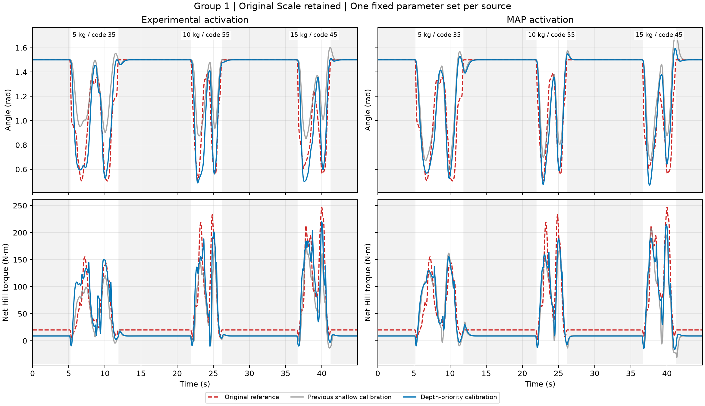

# 项目整理及使用说明

**本地输入：** GitHub 包含演示源代码和此前已发布的输入。当前 528 标定包、其他受试者数据、投稿稿件与生成产物保存在本地研究目录。新克隆或 worktree 的输入文件位置见 [Demo 说明](Demo/README.md#local-inputs)。下文部分历史结果引用本地文件。

**528 / 725 / 730 九工况与 75% 阈值：** `demo_nine_case_75pct` 查看最新 BSE/NMPC 对比、腹部扭矩和软限位扭矩。每 subject/source 固定一套 BSE 参数，每 subject 单独调整 NMPC。黑色水平虚线是各工况不辅助背部峰值的 75%。[工况清单、方法和运行说明](docs/NINE_CASES_75PCT.zh-CN.md)。逐工况问题也在图集和 CSV 中保留，历史版本说明如下。

**725 最新跨速度 BSE：** 检查 5/10/15 kg × 25–65 后，按用户要求完全排除 5 个没有 torque 支持的动作，联合标定剩余 **10 个**，优先其中 35–55 的 **6 个**。`demo_725_bse_speed_grid` 展示两种 activation 的角度、净/背部/腹部 torque 和完整等待段软限位；每来源固定一组参数。[方法与限制](docs/EXP_SPEED_GRID.zh-CN.md) · [定量结果](docs/exp_speed_grid/summary.zh-CN.md)。MAP 冻结，本轮未重调 NMPC。

**此前三负载 BSE/NMPC 流程：** MAP 使用 excitation 数据，BSE/NMPC 负载限定 **5、10、15 kg**。`demo_exp_subjects` 保留上一版三动作标定与 NMPC 结果；其 725 控制图不对应本轮跨速度 BSE。617、627、730 的已有模型保留。[上一版方法、图和限制](docs/EXP_THREE_LOADS.zh-CN.md)。

**CEINMS 力矩 reference 核查：** `demo_ceinms_reference_audit` 展示原导出、A=0.1 回算及被动项力矩。54 份记录均体现主动项简化规则；无独立力矩/外力目标，目前候选不能称为真实校准 reference。[计算、图和限制](docs/CEINMS_REFERENCE_AUDIT.zh-CN.md)。

新数据另存于原 `Data` 下并列的 **`240725Exp_A01`、`240730Exp_A01`**，各含 25、29 份记录。原结果在新目录中归档，新 `Torque.sto` 明确为模型估计；原始目录未修改。

**Exp 激活输入更新：两组统一 A = +0.1。** 运行 `demo_exp_activation_A01` 看背部、腹部及 25/23 工况的前后对照。已重算激活并生成独立参数配置；这轮未重训 BSE/MAP/MPC。[结果及运行说明](docs/EXP_ACTIVATION_A01.zh-CN.md)。

**Exp 最新审查：每工况一组完整 M 峰。** 使用用户确认的现有 IK，240725Exp 保留 25/25、240730Exp 保留 23/25 个工况候选。运行 `demo_exp_data_review` 看图；这些是数据审查，还没有训练新的 Exp BSE/MPC。[逐工况结果与剩余问题](docs/EXP_ONE_CYCLE_REVIEW.zh-CN.md)。当前优化版用 MATLAB 入口、Python 训练/MPC、C 物理求解器；保留的 `.slx` 属于原实现，[程序分工说明](docs/PROJECT_RUNTIME.zh-CN.md)。

**新增 Exp 检查（2026-10-20）：240725Exp / 240730Exp 都有五档负载，各 25 组基本记录。** 两组每档都有完整 EMG 候选，优先整理 240725Exp；较短 activation 导出仍需恢复处理后验收。[负载清单、质量问题和覆盖图](docs/EXP_DATA_AUDIT.zh-CN.md)。当前五负载目录覆盖组为 240528Pilot、240617Pilot、240725Exp、240730Exp。

**MAP 数据覆盖更正（2026-10-16）：当前新增 subject 的 MAP 实际只使用 5 / 10 / 15 kg。** 全部六组中只有 **240528 / 240617** 有五负载覆盖；首选 240528，240617 中间负载需恢复 activation 处理后再验收。其余四组缺少目标负载。[完整 subject 选择清单](docs/MAP_SUBJECT_SELECTION.zh-CN.md)；[逐文件复核及完整 EMG 证据](docs/MAP_DATA_COVERAGE.zh-CN.md)。此前“合格”不代表五负载训练已经完成。

**多 subject 最新入口：`demo_hill_subjects`。** 本轮减少过度助力，使需要辅助的动作峰值更接近阈值下方。240627 的 5 / 10 / 15 kg 峰值分别为 **95.6–97.5 / 137.3–138.0 / 178.0–178.5 N·m**；两组 subject 共 48 个动作/activation 组合均无超限、无新增角度谷点。BSE/MAP、输入和 reference 保持不变。`('threshold-replay')` 复算，`('tune')` 仅重新调 MPC。[控制器修改与限制](docs/MPC_THRESHOLD_TRACKING.zh-CN.md)；[调整前后完整图集](docs/mpc_threshold_tracking/threshold_tracking_results.pdf)。

此前的质量优先训练先核对原生时间戳、断档及与 240528 一致的 activation 平滑。240617 / 240627 合格，已重新训练 MAP 和全部可优化 BSE 参数；其余三组因质量或覆盖不足未重训。[数据质量与训练说明](docs/QUALITY_FIRST.zh-CN.md)。240617 的软限位瞬时峰值在本轮减少助力后约为 65.15 N·m，图集单独显示。`('train')` 重新运行质量优先训练；`('archive')` 查看历史五组结果，`('replay')` 复算历史冻结参数。

原 subject 的 MPC 已加入按状态退出的回正辅助：全部九工况/两种 activation 的最大动作后背部尾峰由 **34.55 降至 15.02 N·m**，18 条曲线都保留两个主要谷值。[优化前后图集](docs/hill_mpc_evaluation/mpc_recovery_before_after.pdf)。`demo_hill_mpc_plots(false)` 直接查看，`demo_hill_mpc` 重新运行。

**当前推荐入口：`demo_hill_sequence`，也可显式运行 `demo_hill_neural`。** 最新版本按原完整记录连续模拟 5→10→15 kg 和直立等待，每种 activation 用一组固定参数覆盖全部九个负载/速度工况；身体/负载几何与软限位共享。输入端的神经调节只改变肌肉激励，实际 theta 和 torque 由同一个弹性肌腱 Hill 系统联立产生。

最新版本修正了之前弯腰只到约 0.9 rad 的问题：**实验来源两个谷值均在 0.488–0.596 rad，MAP 在 0.470–0.654 rad**，两种来源各有 9/9 个动作保留 W 形。新增由同一 Hill 模型估计的负载持续激活补偿，中间起身更充分；输出检查放宽到 −0.3–2.3 rad，theta 不裁剪，reference 原 Scale 不变。

含等待过渡的背部/腹部峰值分别为实验 229.0/35.7 N·m、MAP 217.1/17.4 N·m。软限位启用在 0.05–1.9 rad 之外，本次实际边界力矩为零。净力矩 RMSE 为 42.3/39.6 N·m，theta RMSE 为 12.2/11.3°。这些是九工况标定后的模型回放，尚无独立肌肉力矩或留出验证。[运行、完整公式、九工况结果及限制](docs/HILL_NEURAL.zh-CN.md)。

在 MATLAB 中打开本项目根目录，执行：

```matlab
demo_hill_sequence;
```

无需重新训练或 Python，结果保存于 `results/hill_neural_sequence/`。图表包含两种 activation、torque/theta 对原 reference 的拟合、腹部主动/被动/阻尼力矩，以及实际边界力矩。腹部显示正的屈曲幅值，在净关节力矩中以负号相减，单位均为 N·m。



[全部九工况两个谷值的深度对比](docs/hill_neural_evaluation/valley_depths_all_conditions.png)；
[背部/腹部力矩对比](docs/hill_neural_evaluation/muscle_recruitment_group1.png)。浅弯腰版本的参数保留在 `data/processed/hill_compliant/neural_models_shape_baseline.mat`。

历史入口仍保留：`demo_hill_compliant` 为上一版双 Hill 标定及速度留出对比；`demo_hill_recruitment_audit` 核查其大共同收缩问题，原约 65%–72% 的腹部抵消比例属于该旧模型。[旧版核查](docs/HILL_RECRUITMENT_AUDIT.zh-CN.md)、[旧版双 Hill 模型](docs/HILL_COMPLIANT.zh-CN.md)、[连续实验协议](docs/HILL_SEQUENCE.zh-CN.md) 和 [当前模型结构图](docs/HILL_MODEL_STRUCTURE.zh-CN.md) 分别记录。

`demo_hill_forward` 是早期单肌肉、刚性肌腱基线；其拟合仍不理想，保留用于对照。[旧版本说明](docs/HILL_FORWARD.zh-CN.md)。

力矩诊断：运行 `demo_bse_torque_breakdown`，查看旧 BSE 边界力矩，以及新模型的惯性、重力和内部虚拟阻抗。[设置、图表和解释](docs/BSE_TORQUE_BREAKDOWN.zh-CN.md)。

历史角度平衡点 surrogate：`demo_bse_angle_priority`，其有界角度和逆动力学 torque 不符合当前“同一 Hill 系统”要求，仅保留为历史记录。[历史方法和限制](docs/BSE_ANGLE_PRIORITY.zh-CN.md)。

双输出对比：运行 `demo_bse_torque_theta`，查看原 BSE 与新降阶候选模型的
torque、theta 对 reference 的拟合。[方法、图表与限制](docs/BSE_TORQUE_THETA_COMPARISON.zh-CN.md)。

新增：运行 `demo_bse_generalization` 可查看 BSE 标定目标诊断及跨负载/速度的
力矩估计对比。[优化建议与实际结果](docs/BSE_OPTIMIZATION_REPORT.zh-CN.md)。

本项目已按“共享代码、模型变体、实验配置、数据、结果、文档”整理。
410 个有效 MATLAB 文件合并为 174 份独立实现，保留了 38 个实验配置。
同名但内容不同的函数分别保留，避免误用其他实验的模型。

原文件夹名称涉及上肢外骨骼，但现有说明和主要方程针对 BSE 背部支撑外骨骼、
L5/S1 运动，因此没有擅自更改模型的解剖学含义。

## 运行一个示例

在 MATLAB 中打开本项目根目录，然后执行：

```matlab
setup_project;
workDir = prepare_workflow('map_predictor');
cd(workDir);
[weights, XP, MEP] = MAP_model(45, 10, 'SM', 'baseline_data.mat');
plot(MEP);
```

运行原来的 MAP 对比图脚本：在同一工作目录执行 `test_MAP`。
其他主要实验入口见英文 [README](README.md)，全部配置见
[WORKFLOWS.md](docs/WORKFLOWS.md)。`list_workflows` 也可列出全部配置。

每次准备实验都会在 `results/` 创建新工作目录，复制匹配的代码和输入数据。
不要对整个项目使用 `addpath(genpath(...))`，否则同名模型函数可能冲突。
修改代码时请修改 `src/` 中的正式文件，再重新准备实验；`results/` 中是运行副本。
各标定阶段不会自动传递新参数，需要将前一阶段输出明确提供给后一阶段。

## 数据与 GitHub

- `data/processed/`：运行所用的 MAT 数据和已保存参数，合并了完全重复的文件。
- `data/raw/`：本地原始采集数据，默认不提交 Git。
- `docs/reference/`：原论文、图表、说明文档等，本地保留，默认不提交 Git。
- `results/`：运行副本与结果，默认不提交 Git。

原始项目另有完整备份。`docs/file_inventory.csv` 可查询每个原文件的去向。
GitHub 上传包不包含原始采集数据；别人可以运行已准备数据的示例，重建原始
信号时则需要按 `data/raw/README.md` 配置采集数据。

## 整理范围与验证

统一了代码缩进、空格、换行和 UTF-8 编码，补充了英文功能说明，移除了部分
超长废弃数值注释；整理了 MAP 公共函数，增加预分配及明确的 MAT 变量加载。
原来写死的个人电脑路径已改为统一的数据目录配置。

MATLAB R2023b 下通过了代码分析、全部 38 个配置的目录准备检查和 MAP 示例。
MAP 输出、低通滤波及 500 点几何模型计算与原版结果完全一致。
`demo_legacy_mpc` / `demo_hill_mpc` 已接入当前双 Hill 模型并修复控制约束。
两种 activation 各固定一组参数验证九工况，18 个动作都保留 W 形双谷，
15 kg 角度范围约 0.47–1.60 rad。见 [修复后的 MPC](docs/HILL_MPC.zh-CN.md)。
`demo_hill_mpc_plots` 只从已有结果重画全部对比图，`demo_hill_mpc_plots(false)`
直接打开已有图（无需 Python）。[带力矩阈值的完整 11 页对比 PDF](docs/hill_mpc_evaluation/optimized_model_and_mpc_headroom.pdf)
包含三组连续动作、两种 activation 的九工况 θ/torque，以及辅助前后的腰腹和软限位力矩。
当前 MPC 每 20 ms 更新，预留 35 N·m 余量，背肌权重为 128，角速度权重为 100，保留 80 N·m 上限及 200 N·m/s 变化率限制。
相对上一轮权重 16 的 MPC，实验/MAP 的平均正超阈值量下降 99.05% / 100%，18 个动作均保留双谷。
实验输入剩余最大超出量为 7.84 N·m，对应执行器已饱和，累计超出阈值 1 N·m 以上的时间为 0.12 s；MAP 为零。
见 [MPC 调节前后及剩余尖峰](docs/hill_mpc_evaluation/mpc_headroom_before_after.pdf)。
原来的失稳分支可通过 `demo_legacy_mpc_archive` 复现，见
[旧 MPC 测试报告](docs/LEGACY_MPC_TEST.zh-CN.md)。
没有重跑所有 GA 标定及全部 NMPC 分支；历史脚本的已知问题见
[KNOWN_LIMITATIONS.md](docs/KNOWN_LIMITATIONS.md)。
