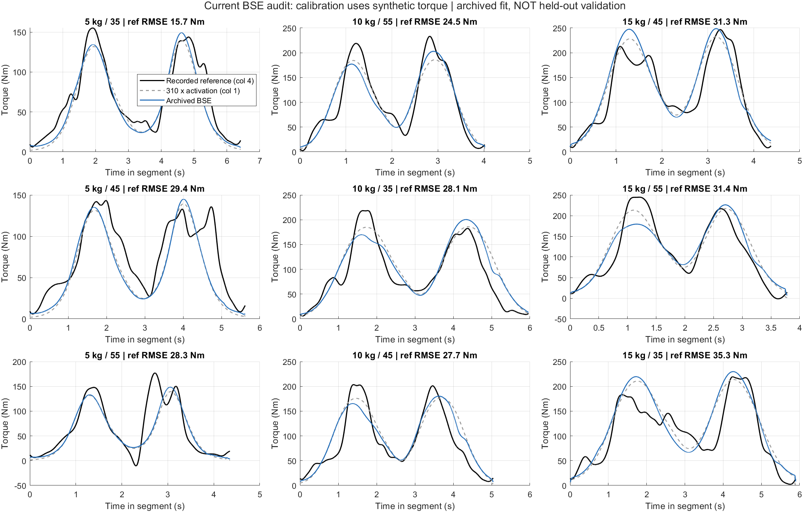
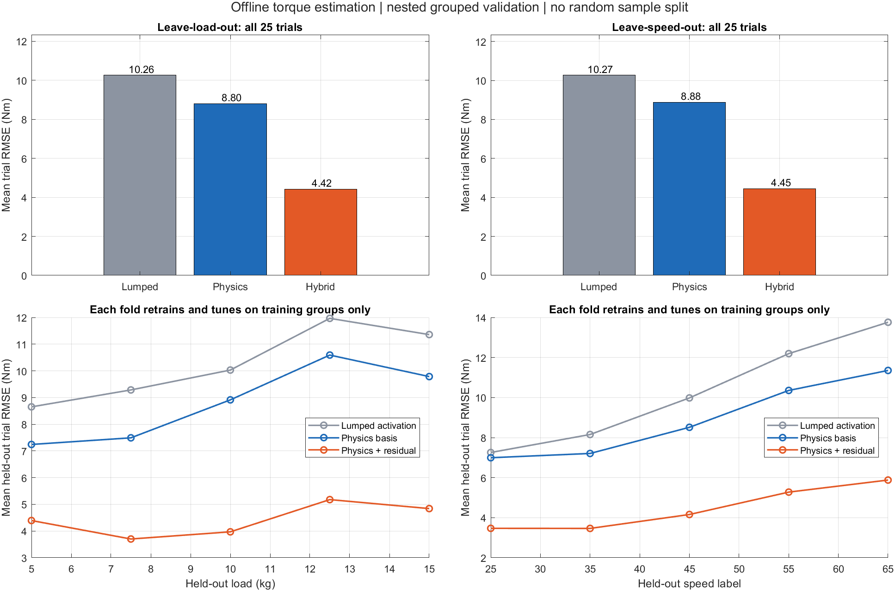
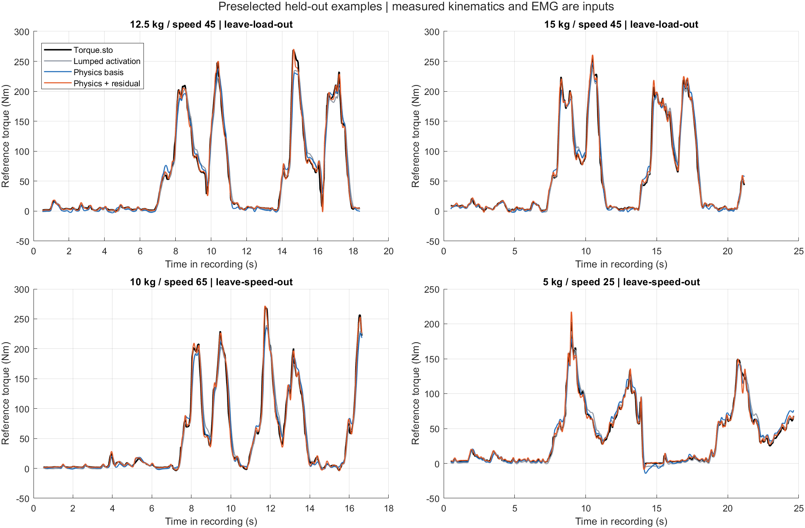

# BSE 拟合与泛化诊断及改进实验

日期：2026-10-12。代码与数值验证环境：MATLAB R2023b。

优先建议是统一标定目标、修正工况表达与验证方式，再优化模型结构。
当前证据不足以把问题主要归因于 GA 搜索能力。另一个值得推进的方向是
“低阶物理项 + 正则化残差”：本次已经实现并完成了整种负载、整种速度留出的
离线力矩估计实验，但它还不是完整 BSE 前向动力学或 NMPC 的替代实现。

## 1. 当前模型中发现的具体问题

本节重点审查 `training_map__muscle_tendon__general_model_op_scale` 版本。
项目还存在其他历史版本，不能默认它们有完全相同的问题。

### 标定目标与展示目标不同

在 [MAP 数据构建脚本](../src/workflows/training_map__muscle_tendon__general_model_op_scale__build_data/MAP_output_model_fusion.m)
中，有以下赋值：

```matlab
Combination(:, 4) = Combination(:, 1);
Combination(:, 1) = 310 * stitched_signal;
```

随后 [训练脚本](../src/workflows/training_map__muscle_tendon__general_model_op_scale/Train_Lumped_muscle_model_EMG_and_LMT_to_MTF.m)
将第 1 列传给标定目标函数，而
[评估脚本](../src/workflows/training_map__muscle_tendon__general_model_op_scale/Lumped_model_check_with_coeffs_thesis_combination.m)
又将预测力矩与第 4 列比较。

三个组合 MAT 文件逐点验证均满足：第 1 列恰好等于 `310 × 第 2 列`，
最大数值差为零。因此这里不能简单说“第 4 列写错了”；在这个处理阶段，
第 4 列保留的是原始参考力矩，第 1 列已经变成人工目标。

按原目标函数中的九段窗口、原保存参数重新运行 BSE，逐段 RMSE 的平均值为：

| 比较对象 | 平均 RMSE |
| --- | ---: |
| BSE 预测 vs 人工目标 `310 × activation` | 8.09 Nm |
| BSE 预测 vs 第 4 列参考力矩 | 27.97 Nm |
| 人工目标 vs 第 4 列参考力矩 | 27.33 Nm |

这支持“模型努力拟合的曲线与希望展示的曲线并不相同”这一诊断。
这些是已有标定工况的表观拟合误差，不是泛化成绩。



### 工况、状态与角度处理限制泛化

- **负载按样本号确定。** `local_load_and_inertia` 使用固定的 `k` 区间设定
  5/10/15 kg。换采样率、动作时长或拼接顺序，外部负载就可能错位。
  应把随时间变化的负载/接触状态显式作为输入。
- **多个动作拼接后连续积分。** 当前脚本将三组 `Combination` 合成一个序列。
  各次独立实验没有独立的状态初始化，容易让参数去补偿拼接过渡。
  应逐试次模拟，共享生理参数，单独处理每段初态。
- **角度被逐试次归一化。** `Dynamic_kine_reference` 将角度映射到固定区间。
  不同动作幅值会被压成相同范围，不利于保持真实几何意义。应确认腰椎角、
  躯干角与模型坐标的关系，使用一致的坐标变换；EMG 则使用统一的 MVC 或
  训练集标定尺度，而不是按测试动作单独调幅。
- **角度目标权重非常大。** `calculate_cost_hybrid` 中包含
  `50000*(1-R)`，同时还有加权角度范数与力矩范数。相关性对偏置/增益
  不敏感，各项又没有按量纲与样本数统一尺度，可能以牺牲力矩或幅值换取形状。
- **低激活时有参考角度反馈。** 模型使用 `theta_real` 的 PID 平衡项。
  因此角度跟踪表现不能直接解释为无参考轨迹的自由前向预测能力。
- **拮抗肌信息未真正进入当前方程。** 此版本 `activation_front` 只在接口中出现，
  `T_front` 分配后未进入输出动力学；而调用端第 4 列还可能是参考力矩。
  需要先明确接口，再决定是否建模腹背肌共同收缩。

## 2. 建议按这个顺序改进 BSE

### 第一优先级：统一数据含义与目标函数

将匿名四列矩阵逐步改为有名称的结构体，例如
`time, torqueReference, activationBack, activationFront, angle, loadKg, trialId`。
人工激活对应的力矩估计可保留为对照，但不替代最终要拟合的参考力矩。

目标函数建议按独立试次等权累加：

```text
J = mean_trial[ wT * mean(Huber((Tpred - Tref) / sT))
              + wQ * mean(Huber((qpred - qref) / sQ)) ]
    + lambda * || log(p / p_prior) ||^2
```

`sT` 和 `sQ` 只由训练数据或预先规定的测量误差确定；正参数使用有界或
对数参数化。先使用与测量误差相容的权重，再做验证集敏感性分析。
不要用逐点随机拆分去选择这些权重。

### 第二优先级：先让状态方程可泛化，再增加模型复杂度

让负载、辅助力矩、采样间隔成为显式输入；每个试次重置状态；对初始肌腱力
使用平衡条件或有正则的初态估计。把“已测轨迹驱动的肌肉力矩估计”和
“无真实未来角度输入的前向预测”定义成两个明确的实验。

先用固定几何参数、少量肌肉强度/阻尼/激活时延参数校准，再做参数敏感性
与可辨识性分析。特别是力臂、最大等长力、肌腱长度等参数可能互相补偿；
若灵敏度矩阵的列高度相关，应固定其中一部分，而不是增加 GA 代数。

### 第三优先级：补充有依据的动态项

优先检查 EMG 到激活的时延与上升/下降时间常数、伸缩方向相关的力速关系、
拮抗肌共同收缩及角度相关力臂。已有混合神经肌肉骨骼模型研究将实测 EMG
与优化信息结合，处理缺失肌肉信息及测量伪差，但这并不意味着可以直接把
参考力矩作为在线输入。[Sartori 等的混合建模研究](https://pubmed.ncbi.nlm.nih.gov/25458151/)

### 第四优先级：用小规模残差模型补偿系统误差

目前数据包含的独立工况数量有限，先试岭回归、少量基函数或带不确定性的
高斯过程，比直接增加大型网络更容易审查。保留物理模型，并仅让数据模型
学习有规律的残差。相关研究已经用神经肌肉骨骼模型提供的物理特征辅助
力矩估计，并研究预测不确定性；本项目的线性残差实现是较轻量的工程候选，
不是对该论文方法的复现。
[Zhang 等，2023](https://pmc.ncbi.nlm.nih.gov/articles/PMC10498472/)

如果进一步接入 NMPC，残差应在状态方程或观测方程中的位置明确，限制幅值与
变化率，对训练分布以外的输入回退，并重新验证多步预测、稳定性与计算时间。
仅把修正力矩画得更贴合，不足以证明修改后的前向动力学正确。

## 3. 已实现的新脚本与验证结果

在仓库根目录运行：

```matlab
demo_bse_generalization
```

入口：[demo_bse_generalization.m](../demo_bse_generalization.m)。
详细方法：[实验 README](../experiments/bse_generalization/README.md)。

脚本执行两件事：重新运行原 BSE 做目标诊断；然后从原始传感器记录建立一套
独立的离线力矩估计实验。后者不使用人工 `310 × activation` 目标、拟合后的
MAP 激活或已经在全部工况上标定的 BSE 参数。

数据包含 5 种负载与 5 种速度标签，共 25 个试次。每次外层测试留出整种负载
或整种速度，内层再按同类工况留出选择正则参数。标准化仅使用当前训练集，
各试次等权；不输入参考力矩的历史值、未来值、试次 ID 或速度标签。

| 方法 | 留出整种负载：RMSE | 留出整种速度：RMSE |
| --- | ---: | ---: |
| 单一背肌聚合激活，训练集拟合增益/偏置 | 10.26 Nm | 10.27 Nm |
| 低阶物理启发回归基础项 | 8.80 Nm | 8.88 Nm |
| 基础项 + 正则化残差 | **4.42 Nm** | **4.45 Nm** |

指标为每个试次 RMSE 的平均值。残差方案相对低阶基础项分别降低 49.84% 和
49.92%，两个验证协议中都在全部 25 个试次上改善。完整结果含逐试次 MAE、
RMSE、R²，见 [CSV](bse_evaluation/trial_metrics.csv)。

这里的“低阶物理基础项”含激活、重力方向代理项、负载交互、角速度与角加速度。
残差保留各 EMG 通道、80 ms 历史和低阶交互信息。**它不是原来的完整 BSE ODE**，
所以不能把上表与原 BSE 的 27.97 Nm 直接相减，宣称原模型改善了某个百分比。





## 4. 这些结果能说明什么

它说明：在 `240528Pilot` 数据内部，用真实记录的多通道 EMG、运动学及负载
上下文建立一个有正则的力矩映射，能够比聚合单肌激活/低阶基础项取得更好的
跨负载、跨速度条件预测，值得作为后续 BSE 观测修正模块候选。

它尚不能说明：跨受试者、跨日期、换电极、改变辅助力矩后的泛化已经解决；
也不能证明角度的自由前向预测或 NMPC 闭环性能已改善。已有研究也发现，
校准后的肌肉模型可以改善跟踪任务而没有改善完全预测任务。
[Maceratesi 等，2025](https://journals.plos.org/plosone/article?id=10.1371/journal.pone.0327172)

本次没有通过消融实验单独分离“保留多通道”“加入历史”“加入非线性交互”
各自的贡献，也没有证明该结构优于使用相同完整特征的其他回归器。

另一个必须确认的点是 `Torque.sto` 的上游生成方式：本次把它称为“记录中的
参考力矩”，没有将其认定为独立力传感器真值。如果它由相同 EMG 驱动的模型
计算而来，本实验更接近对该模型输出的近似，不能替代独立动力学/测力验证。

预处理使用固定因果平滑器，但时间对齐采用线性插值，原采集滤波方式也未
重新审计，因此当前结果属于离线实验。50 Hz 重采样不意味着增加了独立试次。
负载目录 `75`、`125` 按 7.5 kg、12.5 kg 解读；速度仅按目录标签使用。

## 5. 已完成的检查与文件

- 原 BSE 在原九段窗口重算；三组人工目标关系逐点核实。
- 新实验在 MATLAB R2023b 完整运行，输出四组 PNG/PDF 图与 CSV/MAT 结果。
- 核查了目标值不进入特征、试次等权、训练/测试负载或速度不重叠、每个试次
  在每个协议中恰好测试一次。
- 原 BSE 方程、参数、原始数据均未覆盖；新增了独立实验代码和小型缓存。
- 本文图表存放在 `docs/bse_evaluation/`，可随 GitHub 仓库保留；每次运行的
  完整输出位于 `results/bse_generalization/`。

与其现在继续扩大 GA 搜索，我建议先以“真实目标 + 显式负载 + 逐试次初态 +
规范留出验证”建立可信的 BSE 基线，再验证残差对前向动力学和控制的增益。
