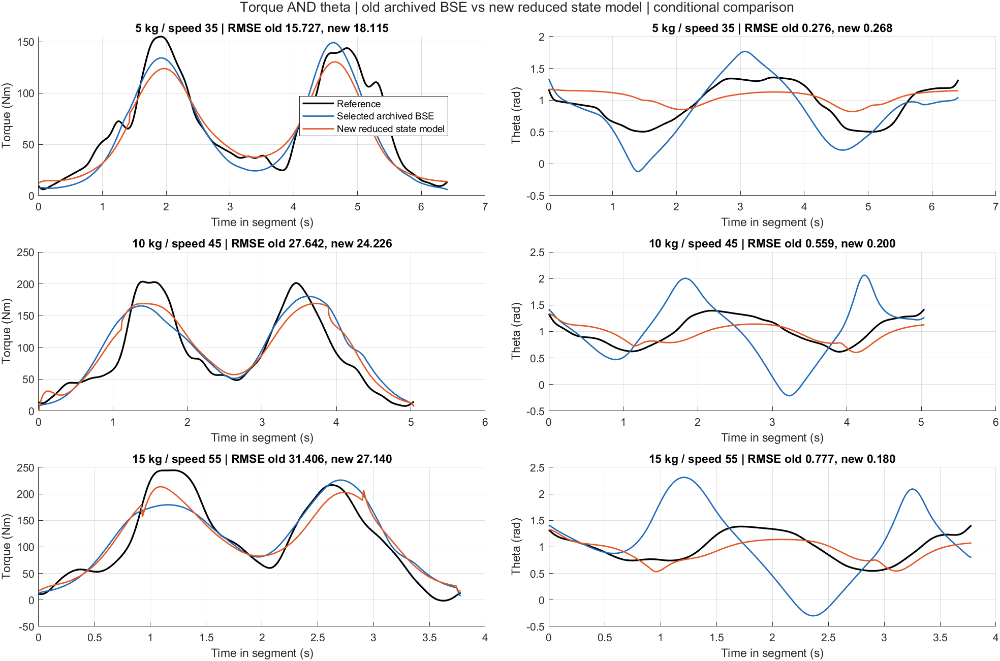

# Torque 和 theta 与 reference 的同时对比

入口：在仓库根目录运行 `demo_bse_torque_theta`。
输出目录：`results/bse_torque_theta/`。

本次补充了独立预测角度的实验。上次的 `demo_bse_generalization` 是已知 EMG
和运动学输入下的力矩估计器，没有 theta 输出；将它输入的实测角度作为预测
角度画出来是不成立的。因此本次新增了一个降阶、双输出状态空间候选模型。
它不是在上次的力矩曲线旁边直接复制 reference。

## 图怎么看



- 左列：torque，单位 Nm；右列：theta，单位 rad。
- 黑线：reference。力矩来自指定组合数据第 4 列，角度来自第 3 列。
- 蓝线：选中的原 BSE 完整动力学模型。
- 橙线：本次新建的降阶状态模型。角度由状态递推得到，力矩由学习的输出方程得到。
- 标题中的两个 RMSE 分别对应蓝线和橙线，均在相同时间点对相同 reference 计算。

总览固定展示 5 kg/35、10 kg/45、15 kg/55，并非按改善最多来挑选。
另外三张 `torque_theta_speed_35/45/55.png` 包含全部九个工况。

## 原版“最佳”的选择依据

目前未指定一个确切的最佳版本，因此对能够直接在相同三组组合数据上运行的
三个通用候选版本重算。各版本使用自己的 `coeffs.mat` 和原始函数，不混用参数。
所有候选均回放 `general_model_op_scale` 的同一组输入，确保 reference 一致。
这不是对项目中所有旧版本、所有单工况专用参数的穷举排名。

| 通用候选 | 九段平均 torque RMSE | 九段平均 theta RMSE |
| --- | ---: | ---: |
| `general_model` | 27.882 Nm | 0.637 rad |
| `general_model_op_damp` | 28.713 Nm | 0.506 rad |
| `general_model_op_scale` | 27.948 Nm | 0.444 rad |

选型标准预先固定为：

```text
jointScore = torqueRMSE / 100 Nm + thetaRMSE / 0.5 rad
```

它是工程上设定的联合权重，不代表唯一正确的最优定义；如果只关心 torque，
`general_model` 的总体均值略低。每个外层测试组仅根据其余六个训练工况选择
蓝线候选，三个分组均选中 `general_model_op_scale`。

如果要固定另一个版本，可以运行：

```matlab
setup_project;
addpath(fullfile(pwd, 'experiments', 'bse_generalization'));
jointResults = compare_bse_torque_theta(pwd, 'general_model_op_damp');
```

可选值为 `auto`、`general_model`、`general_model_op_damp`、`general_model_op_scale`。
重新运行会更新输出图表，文档中的图为本次默认 `auto` 的结果快照。

## 新模型具体如何得到 theta

设角度为 q，角速度为 v，激活为 a，负载时序为 m：

```text
dq/dt = v
dv/dt = omega^2 * (q_eq(a,m) - q) - 2*zeta*omega*v
```

`omega` 和 `zeta` 都为正，因此这个二阶线性状态部分有稳定的极点。
这只说明给定有界驱动下这个数学状态模块稳定，不意味着已经证明人体—外骨骼
闭环控制稳定，也不保证其生理机制正确。

平衡角由少量激活特征和岭回归确定：

```text
q_eq = clip( ridge([a, a^2, a^3, m*a]), 0, 1.7 )
```

训练时只在训练工况中，根据参考角度及其离线导数构造回归目标：

```text
q_eq_target = q_reference
              + (2*zeta/omega)*dq_reference/dt
              + (1/omega^2)*d2q_reference/dt2
```

测试时每段仅使用第一个参考角度设置 `q(0)`，设置 `v(0)=0`。
然后在 0.01 s 步长上采用矩阵指数得到的离散状态转移递推整个片段。
后续 reference 角度和它的导数不参与状态更新，也没有按 reference 做 PID
纠偏、逐点重置或相位对齐。负载时序取自原实验标注的接触窗口。

脚本还执行了直接检查：把测试段第 2 点起的全部 reference 角度和全部
reference 力矩替换成 NaN，新预测必须逐点完全不变。这项检查已通过。

## 新模型具体如何得到 torque

使用预测得到的 `q, v, dv/dt`，结合激活与负载，构建输出特征：

```text
a, a^2, a^3, cos(q), m*cos(q-phi), v, dv/dt,
a*q, a*v, m*a
```

输出力矩由训练工况的参考力矩监督拟合，使用岭回归、训练集特征标准化和
逐试次等权。用于训练力矩输出方程的角度状态，也来自状态模型的滚动结果，
而不是直接用训练 reference 角度替代模型状态。

**这里是学习得到的观测/输出方程，不是原 Hill 肌肉模型的肌腱力平衡方程。**
因此当前候选模型有独立角度状态和力矩输出，但尚不保证二者严格满足原 BSE
的 Newton–Euler 方程。若要求每个肌肉、生理参数和外骨骼作用力都有物理解释，
应回到原 BSE 内部校准或增加有约束的动力学残差，不能直接将这个替代模型
称为“已经修好的原生理 BSE”。

## 训练和测试如何分开

使用三组组合数据中的九个动作片段：3 个负载 × 3 个速度标签。
九段窗口沿用原标定目标的窗口，均在同样的每 10 个原始采样点上评估。
原 BSE 仍按原来的 0.001 s 时间步长运行，再抽取相同评估时间点。

外层每次留出一种完整速度，另外六个工况训练；轮流留出 35、45、55。
内层在剩余两种速度之间继续留出，选择：

```text
omega in [2,4,8,12]
zeta  in [0.7,1,1.5]
```

新模型以同样的 torque/theta 联合指标选择参数，岭回归惩罚固定为 0.01。
三组均选择 `omega=12,zeta=0.7`；最优值在搜索边界，说明这些结果尚不是对
所有超参数的充分优化，也没有在看到测试结果后继续调参来追求更好图形。

## 实际结果及没有改善的地方

| 模型 | 平均 torque RMSE | 平均 theta RMSE |
| --- | ---: | ---: |
| 选中的原 BSE | 27.948 Nm | 0.4441 rad |
| 新降阶双输出模型 | 27.215 Nm | 0.2226 rad |

力矩误差平均只降低约 **2.6%**，角度误差平均降低约 **49.9%**。
力矩改善了九个工况中的五个；角度改善了八个。5 kg/45 工况的两个误差都
没有改善，其完整曲线同样包含在输出图中。

这不是“两个量都拟合得很好”：新角度仍有明显幅值误差，力矩的多峰形状
仍不能完全重现。仅由一个聚合 MAP 激活和负载驱动的低阶模型表达能力有限。

详细数据：[逐工况指标](bse_joint_evaluation/torque_theta_metrics.csv)、
[原 BSE 三候选指标](bse_joint_evaluation/archived_candidates.csv)。

## 比较的边界：不能混淆的三个概念

1. **与上次 4.4 Nm 的区别。** 上次使用原始多通道 EMG 和已测运动学估计力矩；
   本次使用原 BSE 的组合 MAP 输入，而且要自己预测角度。数据、输入和任务都
   不同，两个数字不能直接比较成模型进步或退步。
2. **原版与新版的信息条件并非完全相同。** 原 BSE 按原脚本连续运行整个拼接
   序列，并保留低激活时的参考角度平衡反馈；新模型按片段初始化、仅用一个
   初始参考角度。这是在保留原实现的条件下做的行为对照，不是严格隔离单一
   结构改变的因果实验。
3. **不能称作独立的端到端泛化验证。** 原 BSE 保存参数已经见过这些工况，
   组合数据中的 MAP 及人工调幅也不是在每个外层训练折内重新生成的。
   本次只能称为给定既有 MAP 输入下的条件性留出比较。角度 reference 又经过
   原流程范围映射，不能把这里的 rad 误差直接解释成未经标定的真实腰椎角误差。

后续真正要验证原 BSE 的泛化，应按独立原始试次重做完整的训练流程，包括
MAP、归一化、几何映射和 BSE 标定；同时提供连续负载/接触状态。再在相同
初态、相同传感器信息、无未来 reference 的条件下比较多步 torque/theta。

原方程、原参数、原数据没有被覆盖；新增代码与结果均独立保存。
