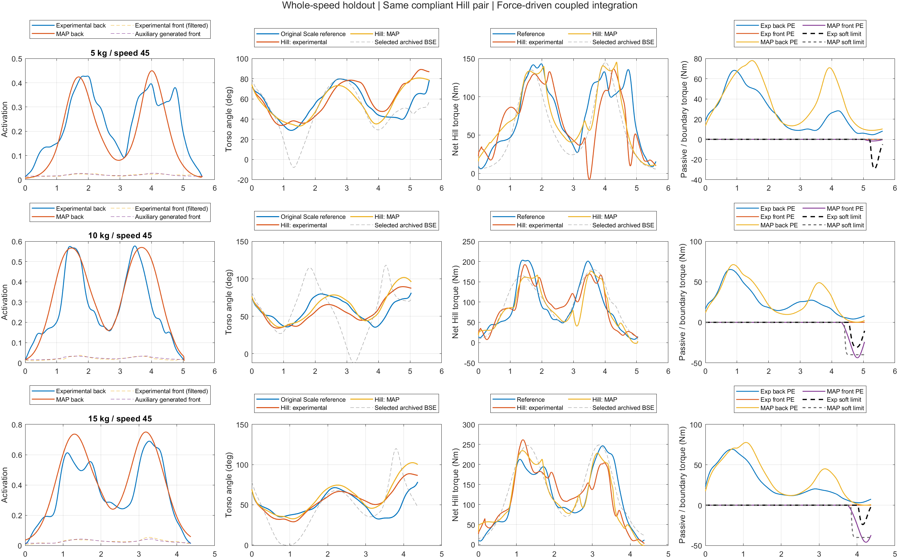
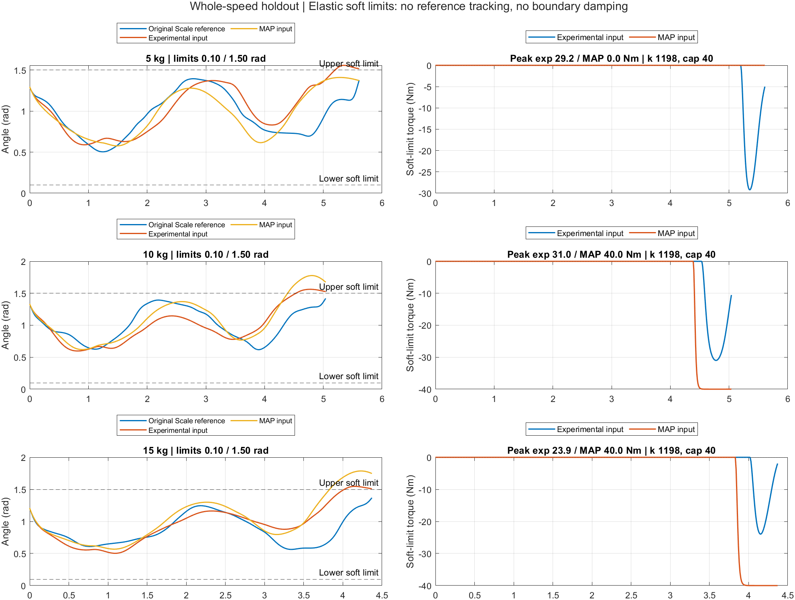

# 同一 Hill 系统的 theta、torque 与 activation 对比

**版本范围：下文是历史双 Hill 基线及其速度留出实验，参数文件为 `calibrated_models.mat`。** 推荐入口现为 `demo_hill_sequence` / `demo_hill_neural`，使用同一机械结构加输入端神经调节，重新减少共同收缩。请查看 [最新九工况固定参数结果](HILL_NEURAL.zh-CN.md)；旧版留出结果不能用于宣称新版已经完成独立泛化验证。

**生理核查更新：当前腹部募集存在缺少独立测量支持的大共同收缩。** 数值稳定与净力矩/角度拟合不能证明内部肌肉分配合理。请同时查看 [腹部激活及力矩核查](HILL_RECRUITMENT_AUDIT.zh-CN.md)，不要将当前前部有效 activation 直接解释为 %MVC。

当前入口是 `demo_hill_compliant.m`。两条作用相反的弹性肌腱 Hill 肌肉共同产生力矩、驱动角度；实验采集与 MAP 生成 activation 使用同一模型方程和求解器。

需要连续 5→10→15 kg、直立等待及腹部肌肉力矩图时，运行 `demo_hill_sequence`，见 [连续工况说明](HILL_SEQUENCE.zh-CN.md)。该入口读取原完整记录；原手写等待段的 1.5 rad/20 N·m 填充值保持不变，不将等待力矩填充值用于动作拟合。

**32 个模型参数全部开放优化**，包括 M、L1、L2、φ、肌肉力量/长度、肌腱应变、激活响应、阻尼、软限位。同一受试者的身体/负载几何与软限位参数在两种输入之间共享，肌肉及激活参数可以不同。

**reference 完全沿用原项目的 Scale**：抽取 `Combination_raw.mat` 第三列，不重新 rescale、平滑、去接缝、平移或修形。原代码调用 `normalize_max_min` 的范围为 0.5–1.4 rad，实际拼接/滤波结果原样保留。0–1.8 rad 只用于检查预测，不改变 reference，也不截断输出。九段逐点审核的最大差异均为 0。

## 运行与图表

当前单关节身体结构、Hill 内部结构和两种 activation 的计算关系见 [模型结构图与解释](HILL_MODEL_STRUCTURE.zh-CN.md)。图中软限位是独立边界项；本次未加入独立外骨骼助力输入。

```matlab
cd('D:\matlab\Journal Paper of Upper-Limb Exoskeleton\GitHub_Ready');
demo_hill_compliant;
```

默认读取项目保存的参数与输入，重新计算全部预测，导出 PNG、PDF、FIG、MAT、CSV，并显示速度 45 的整组留出图。无需重新训练或安装 Python。

| 文件 | 内容 |
| --- | --- |
| `results/hill_compliant/comparison_speed*.png` | 全九组标定：activation、theta、torque、被动/边界力矩 |
| `results/hill_compliant/validation/comparison_speed*.png` | 整组速度留出，同时显示历史 BSE 的 theta 和 torque |
| `theta_focus_speed*.png` | 角度及谷值位置，越界时坐标轴自动扩展 |
| `soft_limits_speed*.png` | 软限位起止角、实际恢复力矩、刚度和饱和上限 |
| `equation_budget_speed*.png` | Hill、重力、关节阻尼、软限位的有符号力矩 |
| `torque_components_speed*.png` | 背部 Hill、前部 Hill 与净 Hill 力矩 |
| `activation_calibration_speed*.png` | 原输入与实际进入 Hill 的 activation |
| `metrics.csv`、`source*_load*_speed*.csv` | 条件指标及逐帧数据；角度 rad，力矩 N·m |
| `convergence.csv`、`stability.csv` | 步长减半检查、超过 60 秒的连续模拟检查 |

上述图在标定目录和 `validation/` 中分别输出。检查后的图与参数还保存于 `docs/hill_compliant_evaluation/`，便于随 GitHub 项目提交。

未编译时自动使用纯 MATLAB 求解器，速度较慢。若已为 MATLAB 配置 C 编译器，可先运行：

```matlab
addpath('experiments/hill_compliant');
build_hill_pair_accelerator;
```

## M、L 和其余参数如何优化

上一版 M=22.6006 kg、L1=0.345 m 固定，仅调整 L2、φ；L2 降到约 0.35 m，明显压低了负载重力矩。

本次 M、L1、L2、φ 联合优化，范围沿用原论文第 3.3 节式 3.72–3.74：M=15–45 kg、L1=0.20–0.35 m、L2=0.345–0.85 m、φ=0–1.1 rad。全九组标定得到：

| 参数 | 上一版 | 本次两种输入共享 |
| --- | --- | --- |
| M | 22.6006 kg，固定 | 29.1977 kg |
| L1 | 0.345 m，固定 | 0.32259 m |
| L2 | 约 0.350 m | 0.79474 m |
| φ | 约 0.05 rad | 0.46440 rad |

theta=0.55 rad、15 kg 已拾起时，新参数的重力矩幅值约 195 N·m，上一版约 110 N·m；实际 Hill torque 还受惯性、肌肉状态、阻尼和软限位影响。

肌肉参数也开放优化：力矩容量 R·F0、R/L0、参考纤维长度比、R、参考肌腱肌肉总长、羽状角、最大纤维速度、肌腱应变、activation 指数/时间常数及募集系数。F0、L0、Ls 从这些参数与几何闭合得到，因此它们也会变化。

重力常数、选定的 Hill 曲线形式和几何坐标基点属于模型定义；实验初始角度/速度属于输入，不作为逐试次拟合自由度。

这些是集中模型的**有效标定参数**，不是独立测得的身体质量/质心。M、L1 的重力作用有乘积耦合，肌肉力量与长度也存在辨识歧义，因此使用弱先验。每个速度留出折仅用其六个训练条件重新标定，不能用全九组参数代替。

完整数值见 `parameters.csv`，单位/上下界见 `parameter_bounds.csv`，是否接近边界见 `parameter_details.csv`；换算回原模型的 F0、L0、Ls、R 见 `derived_muscle_parameters.csv`。这些文件位于 `docs/hill_compliant_evaluation/`。

## 同一 Hill 模型的方程

**仍使用耦合前向积分**：Hill 力矩推进运动，角度再决定肌肉长度；每步联立纤维力平衡、肌腱伸长和关节运动。没有独立拟合的角度平衡点，没有 reference 反馈，也没有用 reference 的二阶导数生成预测 torque。若完全不求解运动方程，需另作准静态假设。

背部/前部方向为 $s_b=+1$、$s_f=-1$，坐标基点 $\theta_{ref}=1.4$ rad：

$$
L_{MT,i}(\theta)=L_{MT,i}^{ref}-s_iR_i(\theta-\theta_{ref}),\quad
L_{MT,i}=L_{M,i}\cos\alpha_i+L_{T,i},\quad
L_{M,i}\sin\alpha_i=L_{0,i}\sin\alpha_0.
$$

令 $\ell=L_M/L_0$、$\nu=\dot L_M/(V_{max}L_0)$：

$$
F_T=F_0[a f_l(\ell)f_v(\nu)+f_{PE}(\ell)+0.03\nu]\cos\alpha,
$$

$$
f_l(\ell)=\exp[-((\ell-1)/0.45)^2],\quad
f_{PE}(\ell)=\max\left(0,\frac{\exp[5(\ell-1)/0.6]-1}{\exp(5)-1}\right),
$$

$$
f_v(\nu)=
\begin{cases}
\max(0,1+\nu)/(1-4\nu),&\nu\le0,\\
(1+6\nu)/(1+4\nu),&\nu>0.
\end{cases}
$$

肌腱只承受拉力，与纤维传递力保持平衡：

$$
\frac{F_T}{F_0}=
\left[\max\left(0,\frac{L_T-L_S}{\epsilon_0L_S}\right)\right]^2.
$$

平衡型弹性肌腱与纤维阻尼参考 [Millard 等，2013](https://nmbl.stanford.edu/publications/pdf/Millard2013.pdf)；这里使用自定义简化曲线，并非逐项复现 OpenSim。

同一肌腱力产生力矩并驱动角度：

$$
\tau_b=R_bF_{T,b},\quad \tau_f=R_fF_{T,f},\quad
\tau_{Hill}=\tau_b-\tau_f,
$$

$$
\dot\theta=\omega,\quad
I(m)\dot\omega=\tau_{Hill}-MgL_1\cos\theta
-mgL_2\cos(\theta-\phi)-B\omega+\tau_{soft}(\theta),
\quad I(m)=mL_2^2+\frac43ML_1^2.
$$

**图中的拟合 torque、CSV 的 `netHillTorque` 均为净 Hill 力矩。** 软限位、重力、关节阻尼另列，不加进肌肉 torque 冒充拟合改善。CE、PE、纤维阻尼也分别保存。

有效负载 m(t) 使用历史拾取/放下区间与固定 80 ms 一阶过渡。它是负载调度假设，没有实测接触力，也没有完整的变质量/接触动量模型。

## 软限位怎样施力

这是**弹性恢复力矩**，由预测角度越界产生；没有 reference 追踪，也没有额外边界阻尼。区间内为零，越界越深恢复力越强并逐渐饱和。令：

$$
d_L=\max(\theta_L-\theta,0),\quad d_U=\max(\theta-\theta_U,0),\quad
P(d)=\frac{d^2}{d+0.05},
$$

$$
\tau_{soft}=T_{cap}
\left[\tanh\left(\frac{kP(d_L)}{T_{cap}}\right)
-\tanh\left(\frac{kP(d_U)}{T_{cap}}\right)\right].
$$

下限产生正力矩，上限产生负力矩；0.05 rad 过渡使起始力矩和斜率连续。k、Tcap、thetaL、thetaU 都参与优化。k 单位为 N·m/rad；角度不会被截断。

全九组共享标定：**k≈462 N·m/rad、Tcap≈149 N·m、thetaL≈0.100 rad、thetaU≈1.577 rad**。下限的 0.100 rad 是保护零角附近的软弹簧先验，允许继续越界，未改变 reference。

每个留出折有自己的训练参数。例如速度 45 留出使用 k≈1198、Tcap≈40 N·m、0.100–1.500 rad；软限位不是把角度固定在该区间，图中仍可超过 1.5 rad。

原历史 BSE 使用 k=1200、Tcap=900 N·m、0–95°，曾出现约 632 N·m 的边界力矩。本次实际峰值和 RMS 见下表，饱和参数不等于实际施加值。

## activation 与训练方式

背部的两种输入使用相同段、负载、reference theta/torque。MAP MAT 第一列的 `310*activation` 是构造值，不作为 reference；reference torque 使用实验 MAT 第一列，也对应 MAP MAT 第四列。

实验前部从 `Activations.sto` 的 `rect_abd_r` 恢复，用固定 120 ms 因果滤波。MAP 没有独立前部输出，辅助生成器用 MAP 背部及负载训练 logit 岭回归；每个留出折仅用六个训练条件的 activation 标签，不使用 test theta/torque、参考相位、时间或速度标签。

两种来源采用同一估计募集形式：

$$
d=LP_{0.10s}(u_b)-LP_{0.35s}(u_b),
$$

$$
\tilde u_f=1-\exp\{-\max[0,g_fu_f+g_bu_b+g_+\max(d,0)+g_-\max(-d,0)]\},
\qquad \dot a_i=(u_i^{\gamma_i}-a_i)/T_i.
$$

背部不采用上述前部募集映射。`activation_calibration` 图展示实际进入 Hill 的 activation。**估计前部募集可能远大于原记录，未经独立测量验证**；因此这是“实验或 MAP 输入 + 募集标定 + 同一 Hill 系统”的候选模型。

训练兼顾标准化角度趋势、峰谷、反向运动、绝对角度、力矩、力矩误差变化率。峰谷标签仅进入训练损失，形状标准化不修改 reference 或预测。绝对角度项权重 0.5、尺度 0.4 rad；力矩项权重 2.0、尺度 70 N·m；力矩误差差分项权重 0.35、尺度 3 N·m；单调性权重 3.0。0–1.8 rad 外有训练软罚项，软限位力矩也单独受罚，避免靠巨大外力维持角度。

每条试次按样本数归一。带边界最小二乘交替优化两个来源的参数块与共享块，没有逐试次调参。部分参数仍触及边界，不能据此声称已找到唯一物理参数。

## 结果与检查

下表为九个条件逐条件 RMSE 的均值，所有条件参与统计：

| 评估 | 输入 | theta RMSE | 净 Hill torque RMSE | 两个主要谷值 |
| --- | --- | --- | --- | --- |
| 九组标定 | 实验 activation | 13.1° | 29.7 N·m | 9/9 |
| 九组标定 | MAP activation | 11.6° | 31.2 N·m | 9/9 |
| 整组速度留出 | 实验 activation | 18.3° | 37.4 N·m | 9/9 |
| 整组速度留出 | MAP activation | 14.3° | 37.4 N·m | 9/9 |

上一版标定力矩 RMSE 为 51.8 / 54.5 N·m，留出为 48.4 / 55.2 N·m。本次标定降低约 43% / 43%，留出降低约 23% / 32%。留出角度误差比之前 16.9° / 12.2° 略大，仍有权衡，不能称为两项都完全拟合。

“两个主要谷值”定义为突出度至少 0.12 rad、间隔至少 0.5 s，只代表 W 的谷值数量。留出 theta 相关性均值为 0.556 / 0.651，匹配谷值时序平均偏差约 0.42 / 0.38 s；峰谷深度和形状仍有差异。

| 实际软限位力矩 | 实验输入 | MAP 输入 |
| --- | --- | --- |
| 标定：全体试次绝对峰值 | 31.8 N·m | 53.0 N·m |
| 标定：试次 RMS 均值 | 2.75 N·m | 2.96 N·m |
| 留出：全体试次绝对峰值 | 31.0 N·m | 40.0 N·m |
| 留出：试次 RMS 均值 | 2.47 N·m | 3.04 N·m |

留出角度范围为约 −0.0091–1.750 rad（实验）、0.268–1.787 rad（MAP）。实验约 0.43% 的样本低于 0，最小值约 −0.52°，原样显示。背部 PE 留出峰值约 147 / 175 N·m，前部约 32 / 46 N·m；PE 的恢复作用仍较明显，需结合分解图判断来源。





灰色历史 BSE 是此前按九组联合分数从三个保存版本选出的版本，含 reference 反馈与边界机制，用于诊断比较；并非整个项目所有历史版本的绝对最佳，也不是未见速度的独立基线。

36 次预测通过两条 Hill 力分解、纤维/肌腱几何、运动平衡、软限位方向与区间内零力、身体几何共享、Python/MATLAB activation 逐点一致、MATLAB/C 一致、reference 隔离和输入因果性检查。步长从 1 ms 减半时最大差异为 0.001154 rad（0.066°）、1.022 N·m。六段超过 60 秒的连续重复输入没有状态重置或持续旋转，角度均处于 0–1.8 rad。

默认后向 Euler 联立求解，Newton 单次修正限幅只是求根保护，不截断角度。初始角度与开始前 10 ms 的原始差分速度保持不变，纤维初态取当前姿态/activation 的静态平衡。松弛肌腱可短于松弛长度，因此纤维求根区间允许到完整可用总长；此前“只允许一份肌腱应变”的窄区间已修正。预测失败直接报错，不把优化器罚值画成结果。

本次为同一受试者已有数据的模型层速度留出。原背部预处理部分为离线滤波；上游 MAP 是否见过留出试次没有在本次排除，结构也用这些条件做过开发。因此结果不代表盲测、跨受试者或整个 EMG→MAP→运动流程的泛化能力。有效几何与募集还需独立测量核对。

## 重新标定

需要 Python、NumPy、SciPy、GCC，依赖范围见实验目录 `requirements.txt`：

```powershell
python experiments/hill_compliant/fit_hill_compliant.py
python experiments/hill_compliant/validate_hill_compliant.py --workers 3
python experiments/hill_compliant/package_hill_results.py
```

输出在 `results/hill_compliant_geometry_fit/`，第三步替换可回放 MAT。留出仅使用同一折之前的训练参数作起点，不使用全九组标定参数。重建原输入时先运行 `prepare_hill_trials.py --raw-root <240528Pilot目录>`，保留原 MAT reference。

参数或代码改变后运行 `demo_hill_compliant`，然后：

```matlab
addpath('tests');
test_hill_compliant;
```

检查通过后，`export_hill_evaluation.py` 同步图表与审核数据到 `docs/`。模型源代码集中在 `experiments/hill_compliant/`，历史版本和本地开发记录保留在各自目录。
