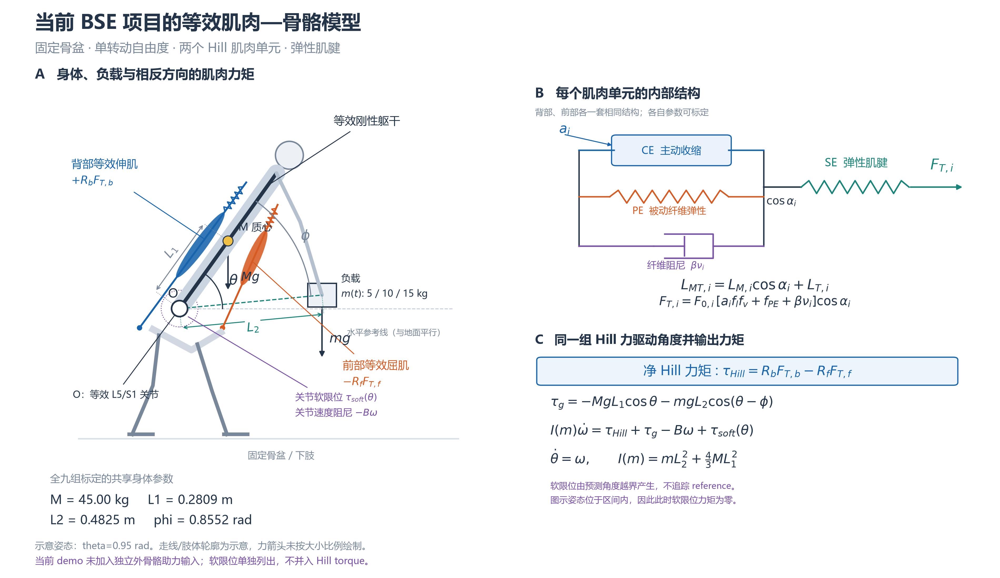
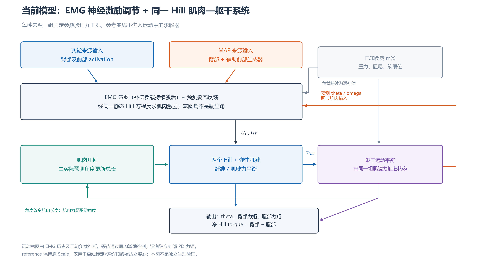

# 当前 BSE 模型的结构与计算关系

这两张图按当前 `demo_hill_sequence` / `demo_hill_neural` 的实际方程绘制。它是 BSE 项目中的**等效肌肉—躯干系统**，包含一个转动自由度、背部/前部两个相反作用的 Hill 肌肉和弹性肌腱，输入端另有 EMG 意图估计及预测姿态反馈。它没有把脊柱的每一节或每一条真实肌肉分别建模。参数、结果和完整输入方程见 [当前九工况报告](HILL_NEURAL.zh-CN.md)。



图中的下肢/骨盆是固定支撑；O 是等效 L5/S1 转动点；theta 是躯干与水平参考线的夹角。弯腰时 theta 减小，伸直时增大。肌肉走线、头部和手臂轮廓是示意，求解器使用等效常数力臂，不从这些画出的附着点计算力臂。

| 图中的量 | 当前模型含义 |
| --- | --- |
| M | 等效上半身质量；全九组标定约 45.00 kg |
| L1 | O 到等效上半身质心的距离；约 0.2809 m |
| m(t) | 拾取/放下过程中附着的有效负载；对应 5、10、15 kg 条件 |
| L2 | O 到负载等效作用点的距离；约 0.4825 m |
| phi | 负载向量相对躯干向量的夹角；约 0.8552 rad，因此负载向量方向为 theta−phi |
| Rb、Rf | 背部/前部等效肌肉力臂；肌肉参数随 activation 来源分别标定 |

这些数值是全九组标定的有效参数，不是独立测得的解剖参数。M 接近优化上界，仍有可辨识性限制；当前版本尚未做独立留出验证。

每个 Hill 单元内部有三个并联分量：CE 主动收缩、PE 纤维被动弹性和纤维阻尼。它们经羽状角投影传递到串联弹性肌腱 SE。两条肌腱只能产生拉力，背部对应伸展方向、前部对应屈曲方向。

肌肉总长与角度使用同一个几何关系：

$$
L_{MT,i}(\theta)=L_{MT,i}^{ref}-s_iR_i(\theta-\theta_{ref}),
\qquad s_b=+1,\quad s_f=-1.
$$

由虚功关系，关节上的肌肉力矩为：

$$
Q_i=-F_{T,i}\frac{\partial L_{MT,i}}{\partial\theta},
\qquad \tau_{Hill}=R_bF_{T,b}-R_fF_{T,f}.
$$

所以用于 torque 输出的肌腱力，也是用于推进 theta 的那组肌腱力。这里几何常数 θ_ref=1.4 rad，不是随时间读取的 reference 轨迹。



实验来源使用项目记录的背部/前部 activation；MAP 使用生成的背部 activation，再补充辅助前部生成器。两种来源采用相同的 EMG 历史/已知负载意图估计、预测姿态反馈和激活动力学，参数可以不同。意图解码补偿由静态 Hill 模型估计的负载持续激活增量，避免把持物激活全解释成下弯。它只决定肌肉激励，不作为输出 theta；实际角度仍由同一 Hill 系统计算。前部输入不能直接等同于原 rect_abd_r 或未经验证的 %MVC。

每个子时间步同时求解纤维/肌腱力平衡和躯干运动平衡：

$$
\dot\theta=\omega,\qquad
I(m)\dot\omega=\tau_{Hill}-MgL_1\cos\theta
-mgL_2\cos(\theta-\phi)-B\omega+\tau_{soft}(\theta),
$$

$$
I(m)=mL_2^2+\frac43ML_1^2.
$$

**这里仍需要耦合前向积分。** 它不是用 reference 角度反算力矩，也不是用另一套独立角度模型生成 theta。角度改变肌肉长度，肌肉状态又决定力矩，二者在同一时间步内联立求解。reference 只用于标定、评价以及一次初始角度/速度；没有后续 reference 追踪。

对你原来的 BSE 路径，本次新 demo 保留了 M、L1、L2、phi 的身体/负载结构，并做了这些处理：

1. 用两个相反方向的等效 Hill 单元表示背部伸肌和前部屈肌。
2. 用单调的弹性肌腱力—应变关系替换高阶肌腱刚度多项式。
3. 用联立隐式求解处理纤维状态与躯干状态，允许肌腱松弛。
4. 取消依赖 reference 角度的纠偏力矩，使用预测状态驱动运动。
5. 开放 32 个物理/募集参数和十个输入端神经参数优化，每种来源固定一组覆盖九工况；身体/负载几何在两种 activation 来源间共享。
6. 加入经你授权的关节软限位，作为独立边界力矩输出。

软限位画在 O 关节处，属于数值模型中的等效边界项，不是 CE/PE，也不等于外骨骼上的实际机械弹簧。它依据预测角度越界产生恢复力，区间内为零；关节速度阻尼 −Bω 是另一项。

**当前 demo 未加入独立外骨骼助力输入或外骨骼连杆/执行器模型，相当于本次没有施加原项目的 Tac 助力。** 因此这张图展示的是 BSE 项目的肌肉—躯干被控对象，不能称为已经完整建模的外骨骼装置。软限位力矩不加进 netHillTorque 的拟合曲线。

所有历史代码仍保留；当前候选模型位于 experiments/hill_compliant。完整公式、软限位设置及标定结果见 [HILL_NEURAL.zh-CN.md](HILL_NEURAL.zh-CN.md)。旧标定的结构图与数值保留在 `hill_compliant_evaluation/`，不代表当前参数。

图有中文与英文版本；PNG 用于预览，SVG/PDF 可放入论文并编辑。

- [英文模型图 PDF](hill_neural_evaluation/musculoskeletal_model_en.pdf)
- [英文模型图 SVG](hill_neural_evaluation/musculoskeletal_model_en.svg)
- [中文模型图 PDF](hill_neural_evaluation/musculoskeletal_model_zh.pdf)
- [英文计算关系图 PDF](hill_neural_evaluation/model_signal_flow_en.pdf)

重新绘制：

```powershell
python experiments/hill_compliant/draw_hill_neural.py
```

绘图需要 NumPy、SciPy、Matplotlib，依赖见 experiments/hill_compliant/requirements-plot.txt；中文字体优先使用 Windows 的 Microsoft YaHei。脚本从 `neural_models.mat` 读取显示参数，不修改预测模型或 reference。
