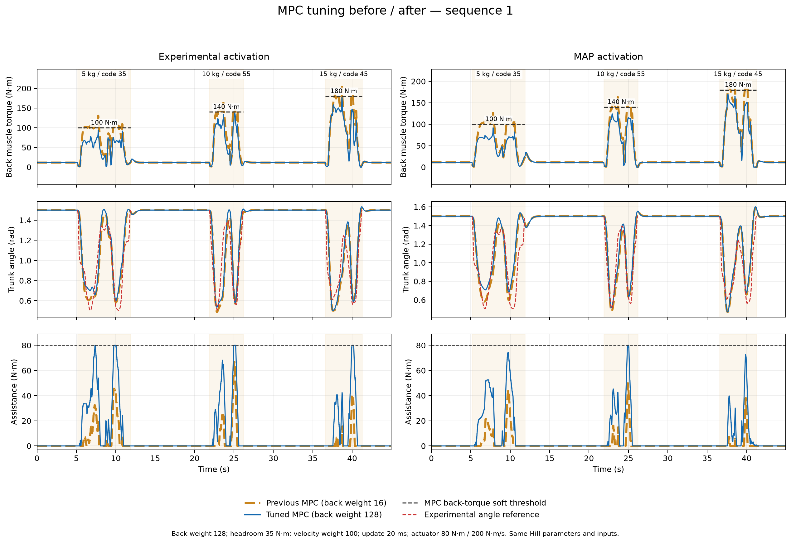
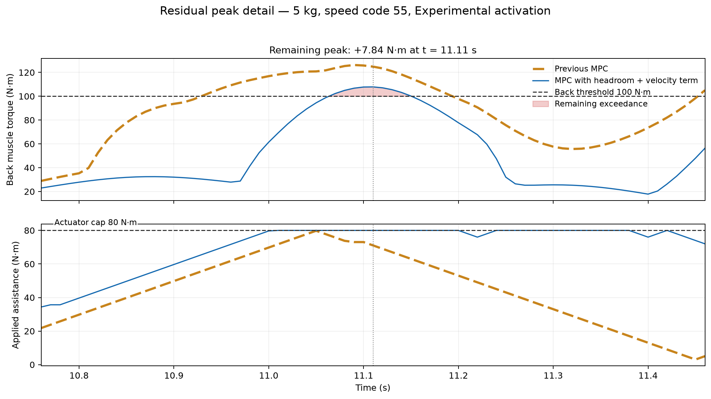
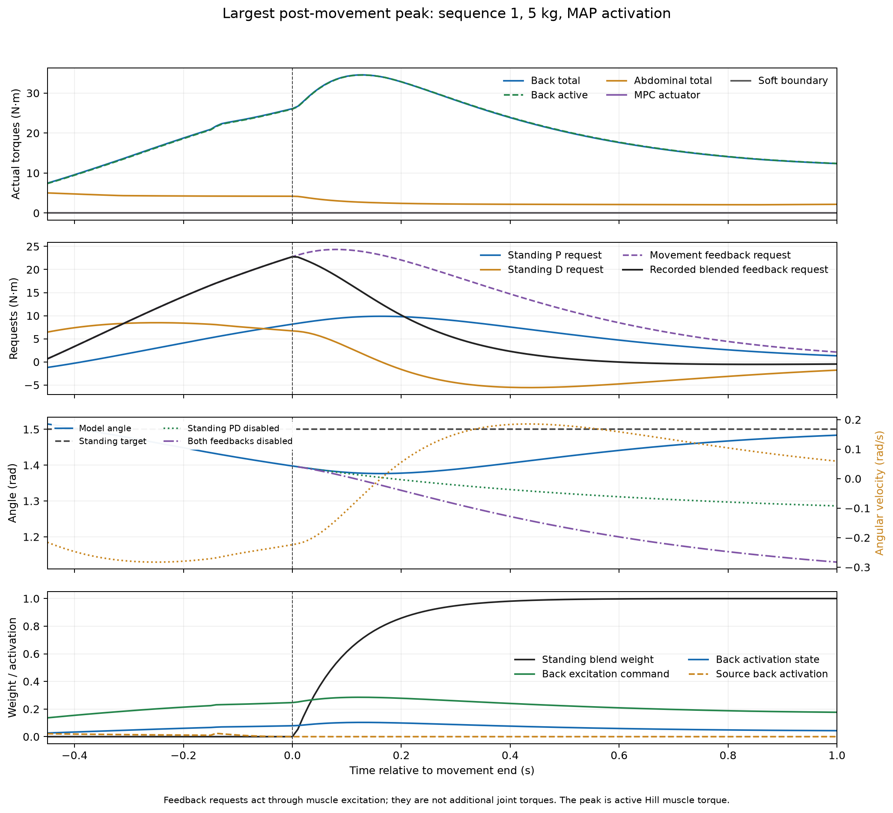
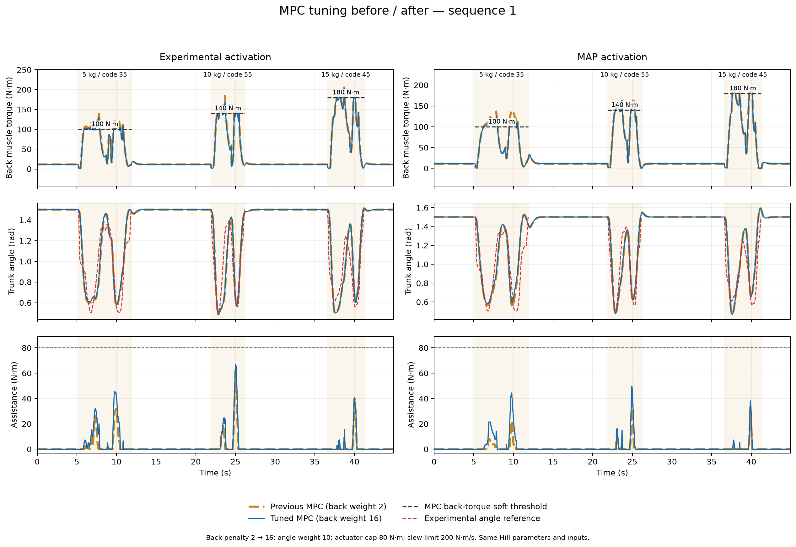
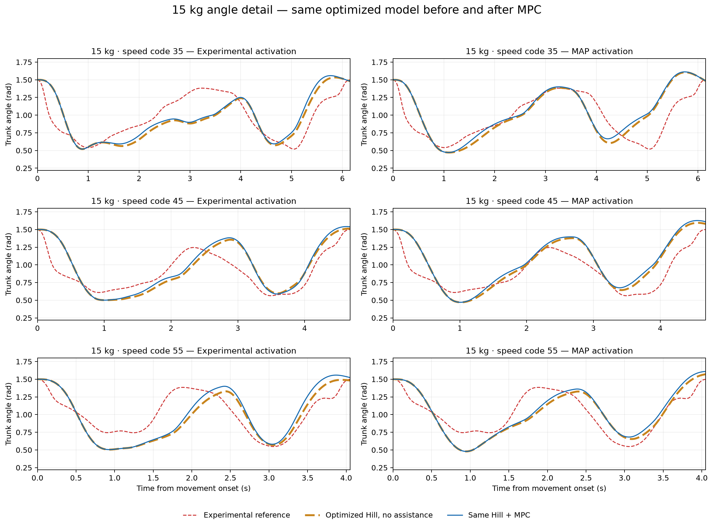
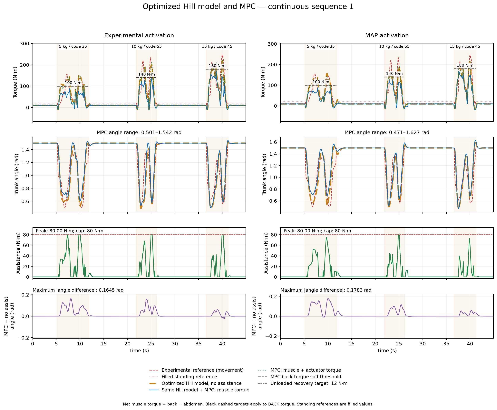
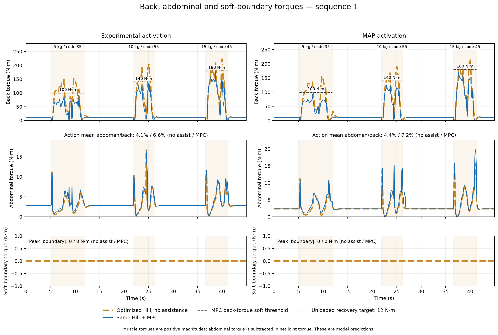

# 修复后的双 Hill / MPC 回放

## 当前新增：动作结束后的状态判别与回正辅助

模型、activation 和原 Scale 保持不变，在原控制器上增加回正阶段的 MPC。已知负载释放、因果运动意图回到直立后即可开始回正；不再只依赖数据片段的结束标记。角度距站立超过 0.025 rad 或角速度超过 0.04 rad/s 时继续预测辅助，满足稳定条件后按原变化率退出。

原 subject 的回正背肌目标为 12 N·m，背肌权重 512、角速度保持权重 10；动作中的 128/35 N·m 裕量设置保持原值。辅助仍限制在 0–80 N·m 和 200 N·m/s，没有改变肌肉参数或增加外加关节 PD。新 subject 的个体化结果另见 [多 subject 说明](MULTI_SUBJECT.zh-CN.md)。

| 18 个动作结束窗口，前 1 s | 退出时机修改前 | 当前 |
|---|---:|---:|
| 最大背肌尾峰 | 34.55 N·m | 15.02 N·m |
| 平均背肌尾峰 | 20.68 N·m | 13.06 N·m |
| 主要 W 谷值数量正确 | 18/18 | 18/18 |

窗口在记录结束处截断。完整比较见 [四页图集](hill_mpc_evaluation/mpc_recovery_before_after.pdf) 和 [逐动作指标](hill_mpc_evaluation/mpc_recovery_metrics.csv)。全部模型/MPC 图见 [当前 11 页图集](hill_mpc_evaluation/optimized_model_and_mpc_recovery.pdf)。100/140/180 N·m 是背肌软目标，当前最差 5 kg 片段仍短时高出 7.84 N·m；硬件上限和变化率均满足，不能把软目标误解为硬截断。

当前 `demo_legacy_mpc` 和 `demo_hill_mpc` 都运行修复后的模型。旧版复现入口改为 `demo_legacy_mpc_archive`。这次同步替换了旧 BSE plant 与预测器，使用已经校验的双 Hill / neural 模型；不是仅给旧曲线改名或只修改一个控制参数。

每种 activation 保留其原先选定的 **32 个物理/募集参数 + 10 个神经参数**，覆盖 5/10/15 kg × 速度代码 35/45/55 的九工况。两来源使用同一模型结构和 MPC 设置；身体、负载几何、软限位与等待控制共享。这次没有重新拟合或逐工况调整模型参数。

## 当前方案：提前辅助并保持角速度趋势（2026-10-15）

上一轮仍有较大短时尖峰，主要问题是辅助启动偏晚：例如一个 15 kg 动作背肌超出约 24 N·m 时，辅助只有 7.52 N·m，100 ms 前还是零。仅增加惩罚权重难以补偿肌肉激活动态、50 ms 控制更新和保持当前输入的预测误差。

比较了包含上一轮在内的 **11 套设置**，每套均覆盖两种 activation、九个工况，见 [候选参数完整核对表](hill_mpc_evaluation/controller_candidate_audit.csv)。当前默认设置为：

- 控制周期 **50 → 20 ms**，更早更新辅助命令。
- 背肌超阈值惩罚 **16 → 128**，在显示阈值下方预留 **35 N·m** 余量；内部目标分别为 65/105/145 N·m，显示阈值仍为 100/140/180 N·m。
- 角度保持权重 10，新增角速度保持权重 **100**，两者都以同一 Hill 模型的无辅助预测为目标。这个项减少提前辅助带来的附加小谷点。
- 执行器仍为 **0–80 N·m、200 N·m/s**；人体模型参数、输入 activation 和 reference 的 Scale 保持原值。

默认预测仍保持当前输入。利用过去 50 ms activation 趋势进行衰减外推的方案也做了对照，但在最差实验尖峰上未优于所选设置，因此没有启用；可用 `--input-forecast trend` 单独复现。所有预测均不读取未来 activation 或实验 θ。

| 全九工况：上一轮 → 当前 | 实验 activation | MAP activation |
| --- | ---: | ---: |
| 动作期间平均正超阈值量，N·m | 1.385 → **0.0131** | 1.626 → **0** |
| 平均正超阈值量下降 | **99.05%** | **100%** |
| 最差瞬时超阈值量，N·m | 42.11 → **7.84** | 36.15 → **0** |
| 累计超出阈值 1 N·m 以上的时间，s | 10.37 → **0.12** | 10.72 → **0** |
| 完全不超阈值的工况数 | **7/9** | **9/9** |
| 超出量不超过 1 N·m 的工况数 | **8/9** | **9/9** |
| 九工况 θ RMSE 的平均值，° | 11.859 → **11.994** | 11.136 → **11.414** |
| 保留主要 W 形双谷的工况数 | **9/9** | **9/9** |

平均正超阈值量为动作段所有采样的 `mean(max(backTorque - threshold, 0))`，包含零值，站立等待不计。所有 10/15 kg 工况均未超过背肌阈值。实验输入剩余的两处超出分别不超过 0.88 和 7.84 N·m；最大者发生于第 3 组 5 kg、速度代码 55 的 11.11 s，背肌为 **107.84 N·m**，实际辅助已经达到 **80 N·m**。这说明该次剩余尖峰与执行器饱和相伴，不能将它解释成仍有可随意增大的辅助余量；也不据此宣称对所有可能控制策略都不可行。

角度保留双谷形状，平均误差相对上一轮略升约 0.14°/0.28°；局部角度的最大变化为 0.241/0.159 rad，反映了加强辅助的代价。背肌仍为主导，腹部力矩没有被人为裁剪。所有优化器结果通过可行性检查，步长减半、追加站立和肌肉力矩一致性检查通过。

[当前调节前后 4 页 PDF](hill_mpc_evaluation/mpc_headroom_before_after.pdf) 包含三组连续记录和剩余饱和尖峰放大图；[逐工况指标](hill_mpc_evaluation/mpc_headroom_comparison.csv)；[汇总、配置和结果哈希](hill_mpc_evaluation/mpc_headroom_summary.json)。图中橙色为上一轮 MPC，蓝色为当前 MPC。





## 动作结束后的回正尖峰：PD、重力与模式切换

针对全部 18 次动作结束，用相同输入和已施加的 MPC 命令重放，重建最后一个内部积分步实际使用的 P/D 请求，并在同一个动作结束状态下分别关闭站立 P、站立 D、站立 PD、运动反馈或两层反馈。人体参数及正式结果没有改动。见 [诊断 4 页 PDF](hill_mpc_evaluation/post_movement_spike_diagnosis.pdf)、[18 次切换指标](hill_mpc_evaluation/post_movement_peak_audit.csv)、[完整反馈曲线](hill_mpc_evaluation/post_movement_feedback_traces.csv)、[诊断来源和回放校验](hill_mpc_evaluation/post_movement_diagnosis.json)。

当前 `waiting` 标记取自实验/MAP 背部 activation 有效区间的边界，不是根据模型已达到直立角度、角速度已接近零来触发。因此数据段结束时，模型可能仍在回落。例如最大尾峰对应的动作结束瞬间，模型角度约 1.398 rad、角速度约 −0.224 rad/s，尚未在 1.5 rad 直立目标处静止。这是切换规则与机械状态之间的时差。

当前站立稳定器的请求为：

$$
c_s=120\tanh\!\left(\frac{80(1.5-\theta)-30\dot\theta}{120}\right),
\qquad \tau_{s,\mathrm{request}}=-\tau_g+c_s-\tau_{\rm assist}.
$$

即 $K_P=80$ N·m/rad、$K_D=30$ N·m·s/rad、$K_I=0$。存储的积分状态在此配置中不产生请求，因此这不是积分 windup。动作期另有 $c_m=K_{P,m}(\theta_{\rm intent}-\theta)-K_{D,m}\dot\theta$；实验/MAP 的 $K_{P,m}$ 约为 206.67/187.32，$K_{D,m}$ 约为 34.02/16.20。它们都是作用于肌肉激励的反馈请求，不是额外叠加到关节的外力矩。

站立权重 $\beta$ 以 0.1 s 时间常数从 0 过渡至 1，记录的混合反馈为 $c=\beta c_s+(1-\beta)c_m$。每条肌肉实际激励采用：

$$
u=\beta u_s+(1-\beta)\big[(1-\alpha)a_{\rm source}+\alpha u_m\big],\qquad \alpha\approx0.7.
$$

因此动作期约 70% 的反馈募集逐渐变为站立期 100% 的反馈募集。站立切换时角度和速度尚未稳定、重力需求随角度变化，加上这项募集比例变化和 Hill 状态延迟，共同形成末端的主动肌肉瞬态。仅把它叫作“阻尼加了一股力”不准确。

以图中第 3 组最后一个 15 kg 动作结束后的峰为例（动作结束 43.94 s）：

| 峰值时刻的诊断 | 实验 activation，44.08 s | MAP activation，44.11 s |
| --- | ---: | ---: |
| 背肌总力矩，N·m | 25.58 | 29.29 |
| 背肌主动项，N·m | 25.46 | 29.22 |
| 背肌被动项，N·m | 0 | 0 |
| 背肌纤维阻尼项，N·m | 0.123 | 0.078 |
| 当前角度下重力补偿需求，N·m | 16.34 | 18.22 |
| 混合回正反馈请求，N·m | 10.70 | 11.91 |
| 实际 MPC / 软限位力矩，N·m | 0 / 0 | 0 / 0 |

实验来源此刻 $\theta=1.4386$ rad、$\dot\theta=-0.1212$ rad/s，仍在向弯腰方向回落。站立 P/D 原始请求分别约 4.90/3.68 N·m，混合权重约 0.742，剩余动作期反馈也在参与。上表的请求量与实际肌肉力矩不能直接逐项相加：请求先经过肌肉募集、激活动态与肌纤维/肌腱联立求解。

同一结束状态关闭站立 PD，在原峰值时刻背肌力矩由 **25.58 降到 20.67 N·m**，说明 PD 参与了该峰；但随后一秒内的最大值反而达到 **34.23 N·m**，因为回落没有被充分抑制，重力需求和动态状态随之改变。关闭 D 也没有消除后续峰值。因此不能简单删除稳定器或把 D 当作唯一问题。

无辅助回放也有同类尾峰，例如该例为 23.52 N·m，说明 MPC 并非出现它的必要条件。所有 18 次结束时的背肌峰值时刻，执行器力矩均为零；结束后的一秒内，执行器最大仅为 0.676 N·m。过去的辅助会改变结束状态，所以不能仅凭峰时执行器为零就排除其历史影响。

最大的尾峰出现在第 1 组 5 kg MAP，结束后 0.13 s 背肌为 34.55 N·m；其中主动项 34.52 N·m，肌纤维阻尼仅 0.028 N·m，软限位和实际 MPC 均为零。它是模型的回正瞬态，不能直接当作独立测量到的受试者肌肉峰值。



后续如需抑制这一尾峰，优先改进从运动到等待的连续募集、按角度/速度稳定程度过渡，以及回正时的制动轨迹；保留重力补偿与必要的稳定反馈。本次只分析，没有替换当前控制器。

复现：`python experiments/legacy_mpc/analyze_post_movement.py --publish`。反事实曲线只从动作结束时刻开始，并重放原后续信号和辅助命令；它们用于局部原因分析，不是重新优化 MPC 后的可部署控制器结果。

## 上一轮仅提高惩罚的结果（存档）

上一轮 MPC 的背肌超阈值二次惩罚权重从 **2 调至 16**。以下为该轮历史结果，当前方案见上节。两种 activation 使用同一套 MPC 参数，每种来源用自己的固定 Hill 参数覆盖九工况。

背肌项为 $J_{\rm back}=w_\tau\sum_k[\max(\tau_{{\rm back},k}-\tau_{\rm limit},0)/30]^2$。分别运行权重 8 和 16 后，选择 16：超阈值量进一步下降，全部 18 个动作仍有与 reference 一致的两个主要谷点。

| 全九工况指标：原 MPC → 加强后 | 实验 activation | MAP activation |
| --- | ---: | ---: |
| 动作期间平均正超阈值量，N·m | 3.493 → **1.385** | 4.150 → **1.626** |
| 平均正超阈值量下降 | **60.35%** | **60.83%** |
| 最差瞬时超阈值量，N·m | 61.68 → **42.11** | 49.42 → **36.15** |
| 九工况 θ RMSE 的平均值，° | 11.988 → **11.859** | 11.227 → **11.136** |
| 相对原 MPC 的动作段最大角度变化，rad | **0.05581** | **0.06354** |
| 辅助力矩峰值，N·m | 63.66 → **79.80** | 37.74 → **59.56** |

“平均正超阈值量”定义为动作段全部采样的 `mean(max(backTorque - threshold, 0))`，包含未超阈值的零值，不计站立等待。18 个工况各自的平均和最大超阈值量都下降；但短时峰值仍可能超阈值，这是软目标，没有裁剪输出曲线。所有优化器结果均通过可行性检查。

[三组调节前后对比 PDF](hill_mpc_evaluation/mpc_tuning_before_after.pdf)；[逐工况指标](hill_mpc_evaluation/mpc_tuning_comparison.csv)；[汇总及前后结果哈希](hill_mpc_evaluation/mpc_tuning_summary.json)。该对比图的橙线是**原 MPC**，蓝线是**加强后的 MPC**；与下方“无辅助/MPC”图的橙线含义不同。



## 优化模型与 MPC 的全部对比图

当前完整回放包含 **11 张图**，合并为 [当前完整 11 页 PDF](hill_mpc_evaluation/optimized_model_and_mpc_headroom.pdf)。所有曲线直接取自已经验证的 `hill_mpc.mat`，没有平滑曲线、移动峰谷或修改 reference 的 Scale。之前的合并 PDF 保留为调参前快照。

图例统一为：**红虚线 = 实验 reference；橙虚线 = 优化 Hill 模型无辅助；蓝实线 = 同一模型接入 MPC；绿点线 = MPC 下净肌肉力矩 + 执行器力矩**。左列为实验 activation，右列为 MAP activation。站立段 reference 是填充值，用淡红点线区分；它不是独立测量的站立力矩。

**黑色水平虚线为 MPC 的背部肌肉力矩软阈值：5 kg → 100 N·m、10 kg → 140 N·m、15 kg → 180 N·m。** 已加入三组连续力矩图、九工况力矩分图和背肌力矩图，实验与 MAP 使用相同阈值。连续图只在动作段画出这些线，站立等待时不启用该 MPC 目标。它约束的是背肌力矩超阈值的代价，允许因角度保持等目标而超过；不是净肌肉力矩或“肌肉＋执行器”总力矩的硬上限。辅助力矩图的红色水平虚线则是执行器 **80 N·m 硬上限**。

每组连续记录都包含 5→10→15 kg 和中间站立等待；下面三组合起来覆盖九个工况。主图从上到下分别为力矩、角度、MPC 辅助力矩、MPC 相对无辅助的角度差值。

| 连续记录 | 5 / 10 / 15 kg 对应速度代码 | Torque、θ、辅助及角度差值 | 背部、腹部及软限位力矩 |
| --- | --- | --- | --- |
| 第 1 组 | 35 / 55 / 45 | [主图](hill_mpc_evaluation/mpc_torque_theta_group1.png) | [肌肉对比](hill_mpc_evaluation/mpc_muscle_and_boundary_torque_group1.png) |
| 第 2 组 | 45 / 35 / 55 | [主图](hill_mpc_evaluation/mpc_torque_theta_group2.png) | [肌肉对比](hill_mpc_evaluation/mpc_muscle_and_boundary_torque_group2.png) |
| 第 3 组 | 55 / 45 / 35 | [主图](hill_mpc_evaluation/mpc_torque_theta_group3.png) | [肌肉对比](hill_mpc_evaluation/mpc_muscle_and_boundary_torque_group3.png) |

| Activation 来源 | 九工况角度分图 | 九工况力矩分图 |
| --- | --- | --- |
| 实验采集数据的 activation | [θ](hill_mpc_evaluation/theta_all9_experimental.png) | [Torque](hill_mpc_evaluation/torque_all9_experimental.png) |
| 模型生成的 MAP activation | [θ](hill_mpc_evaluation/theta_all9_map.png) | [Torque](hill_mpc_evaluation/torque_all9_map.png) |

分图按负载 5/10/15 kg 排行、速度代码 35/45/55 排列。横轴只减去该动作段的起始时间，没有改变采样、持续时间或相位。背部和腹部图使用各自的力矩纵轴，单位都是 **N·m**，便于看到较小的腹部力矩；腹部力矩在净肌肉力矩中被相减。

图中增加了无辅助与 MPC 的角度差值曲线：全记录的最大变化分别为 **0.27213 rad（实验 activation）/ 0.22689 rad（MAP）**。九工况角度 RMSE 的算术平均分别为无辅助→MPC **12.220°→11.994° / 11.321°→11.414°**，仍存在相位和峰谷偏差。逐工况数值见 [模型与 MPC 对比指标](hill_mpc_evaluation/model_mpc_comparison_metrics.csv)。这些拟合指标不构成独立泛化验证。

## 15 kg 原图失真的原因

旧 simulator 的 `theta_real` 赋值为存档仿真 `Theta_Tac0`，而非实验 `Combination(:,3)`。例如实验 activation 的 15 kg 段，40.151 s 时实际角度为 −1.094 rad，被追踪的存档目标为 −0.994 rad，而实验 reference 为 **0.852 rad**。随后角度反弹到 3.384 rad，低激活平衡项达到数百 N·m。

同时，原优化未检查求解退出状态，失败增量仍被施加；块展开重复 10 次，约束却仅限制一次增量和；增量不能为负；关闭辅助时直接归零。原 soft boundary 在 θ>1 rad 时就加入无饱和的位置/速度项，较大角度下的分支又被前一个分支覆盖。

独立的“仅改角度目标”对照仍出现失稳：实验来源全记录达到 −1.011–4.028 rad。这个结果说明不能把失真归结为一个画图问题或只改 reference。该对照保存在 `results/legacy_mpc/control_experimental_reference_only_status.json` 对应的运行目录。

## 本次具体修改

1. **plant 和预测器使用同一套耦合双 Hill 方程。** 肌纤维、肌腱、激活、关节状态、EMG 历史和等待状态一起保存，预测时复制完整状态；真实仿真在三个负载和等待段之间连续演化，不重置。
2. **不再把旧存档角度送进人体模型。** 人体运动意图来自当时的 activation 与已校准的神经模型。MPC 保护的是同一人体模型在无辅助时预测的运动；实验角度 reference 仅用于事后评价与绘图。
3. **完整约束辅助力矩并检查优化结果。** 所有控制块均为 0–80 N·m，块间变化也受约束。实际施加力矩再按 200 N·m/s 速率限制，关闭时平滑下降。失败、非有限或不可行解不会直接施加。
4. **使用归一化二次代价。** 兼顾运动保持、背肌力矩超阈值、腹部过度募集和控制变化，避免旧四次大数值惩罚。关节角度优先，背肌阈值为软目标，并非保证所有背肌峰值都低于阈值。
5. **取消旧外部姿态 PD 力矩。** 站立平衡仍通过 Hill 肌肉激活实现。保留选定模型的弹性软限位，实际每条回放边界力矩均为零。

人体模型的同一个机械平衡式为：

$$
I(m)\dot\omega=\tau_{\rm back}-\tau_{\rm abdomen}
+\tau_{\rm actuator}+\tau_g-B\omega+\tau_{\rm soft}(\theta),
\qquad \dot\theta=\omega.
$$

肌肉力矩来自肌腱张力和力臂；肌纤维长度、肌腱力和下一步关节角度在同一隐式求解中相互耦合。角度不是独立的 reference 插值，肌肉力矩也不是另加的一条拟合曲线。

有辅助时，人体神经控制器从所需总力矩中减去已施加的辅助力矩，再请求腰腹肌肉激活；实际肌肉力仍由 Hill 方程计算。这是对人体助力响应的模型假设，尚未用独立助力实验的 EMG 标定，不能将仿真直接认定为受试者真实助力效果。

## 当前效果

| 15 kg，全部三个速度 | 实验 activation | MAP activation |
| --- | ---: | ---: |
| θ 范围，rad | **0.501–1.554** | **0.471–1.603** |
| 三个速度的 W 形双谷 | **3/3** | **3/3** |
| 相对 reference 的角度 RMSE，° | 11.60–14.12 | 10.58–14.14 |
| 平均腹部/背部力矩比 | 4.3%–7.5% | 5.5%–6.3% |
| 15 kg 辅助力矩峰值，N·m | 80.00 | 72.95 |



橙色和蓝色分别为**当前同一模型**的无辅助与 MPC 回放，不是旧存档的不稳定角度。实验 reference 使用当前项目已经确认的原 Scale，未重新调整。当前使用统一九工况数据包，不能将它与旧 simulator 的单个组合记录当作逐采样点完全相同的前后实验对照。

峰谷时刻仍有偏差，尤其速度代码 35 的部分曲线；当前解决了大幅失稳并保留双谷趋势，不代表角度已逐点精确拟合。全部 18 个动作段的角度相关系数为 0.693–0.906。



全九工况中，实验/MAP 来源的辅助力矩峰值均为 **80 N·m**，没有超过上限，且没有施加被拒绝的 QP 解。背肌力矩保持主导，动作段平均腹部力矩约 **4.81 / 4.57 N·m**，背肌约 **67.98 / 69.03 N·m**。这些均为九工况平均值的算术平均，是模型力矩预测，不能等同于独立测得的肌肉扭矩。

主图中的蓝线为净肌肉力矩；绿点线为净肌肉力矩加辅助力矩。辅助后肌肉力矩下降是预期行为，不能要求它继续逐点重合无辅助实验力矩。15 kg 三速度的背肌峰值相对无辅助下降约 20.7%–24.1%（实验来源）和 20.7%–23.4%（MAP 来源）。



## 数值与一致性验证

- 两来源各一组固定参数，九工况共 18 个动作段，全部保留与 reference 相同的两个主要谷点。对应数值见 [分段指标](hill_mpc_evaluation/movement_metrics.csv)。
- 关闭辅助后，新状态接口与原 MATLAB 双 Hill 回放最大差值为 **4.83×10⁻¹⁰ rad / 1.16×10⁻⁷ N·m**；接口没有悄悄改变无辅助模型。
- 当前相同辅助命令以 1 ms 与 0.5 ms 内部步长重放，角度最大差值 **0.00365 rad**，净肌肉力矩最大差值 **2.64 N·m**。
- 每条记录末尾继续 30 秒无负载站立，不重置状态；末帧角度误差均低于 10⁻⁸ rad。该误差仅表示数值平衡，不表示实际测量精度。
- 实际关节动量方程残差低于 10⁻⁷ N·m；边界力矩及额外姿态平衡力矩均为零。没有裁剪角度输出。

MPC 每 **20 ms** 重规划，预测时域 0.4 s、4 个控制块，默认预测保持当前 activation、载荷和等待标记，不读取未来实验角度或未来 EMG。实际输出为 100 Hz，人体积分内步长为 1 ms。两来源使用相同的控制器配置，相关设置与参数哈希见 [evaluation.json](hill_mpc_evaluation/evaluation.json)。

## 运行

在 MATLAB 中切到 `GitHub_Ready` 根目录，运行：

```matlab
demo_hill_mpc_plots  % 只从已有回放重画全部图，在一个窗口的 11 个标签页中查看
% 或：demo_hill_mpc_plots(false)  % 直接打开已经导出的图，无需 Python
```

重新运行模型和 MPC，再验证并生成全部图：

```matlab
demo_legacy_mpc
% 或：demo_hill_mpc
```

需要 Python 的 NumPy、SciPy、Matplotlib 和 GCC C 编译器。脚本优先使用 `EXO_PYTHON` 或 MATLAB `pyenv` 指定的 Python，并会尝试用户目录下的 Miniconda/Anaconda；该电脑的 MATLAB 入口已经完整跑通。

原始回放、控制器结果和图保存在 `results/hill_mpc`。Python 只画图、不重跑仿真或数值步长核对的入口：

```text
python experiments/legacy_mpc/plot_hill_mpc_results.py
```

添加 `--publish` 同步更新 `docs/hill_mpc_evaluation` 中的 PNG、矢量 PDF、指标和来源文件哈希。重新导出图并做数值核对可运行：

```text
python experiments/legacy_mpc/evaluate_hill_mpc.py
```

旧代码及失稳曲线保留在归档分支和 [原测试报告](LEGACY_MPC_TEST.zh-CN.md)，供检查原因；默认入口不再运行该分支。

本次调参前的连续回放保存在 `results/hill_mpc_before_predictive_tuning`；更早的权重 2 版本保存在 `results/hill_mpc_before_torque_tuning`。重现本次前后对比可运行：

```text
python experiments/legacy_mpc/run_hill_mpc.py --back-weight 16 --back-margin 0 --control-period 0.05 --velocity-weight 0 --output hill_mpc_before_predictive_tuning
python experiments/legacy_mpc/run_hill_mpc.py
python experiments/legacy_mpc/evaluate_hill_mpc.py
python experiments/legacy_mpc/compare_mpc_tuning.py --publish
```
