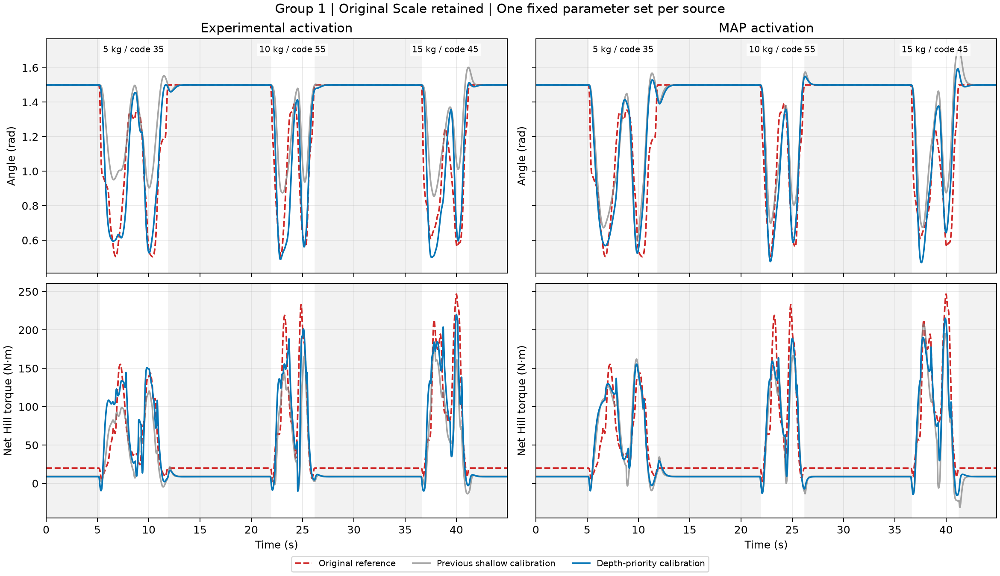
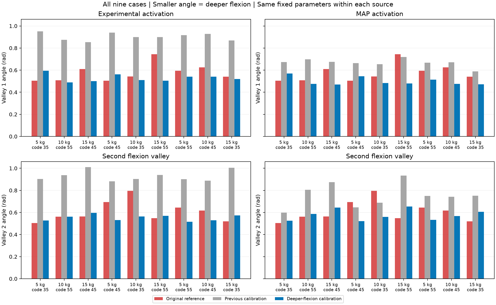
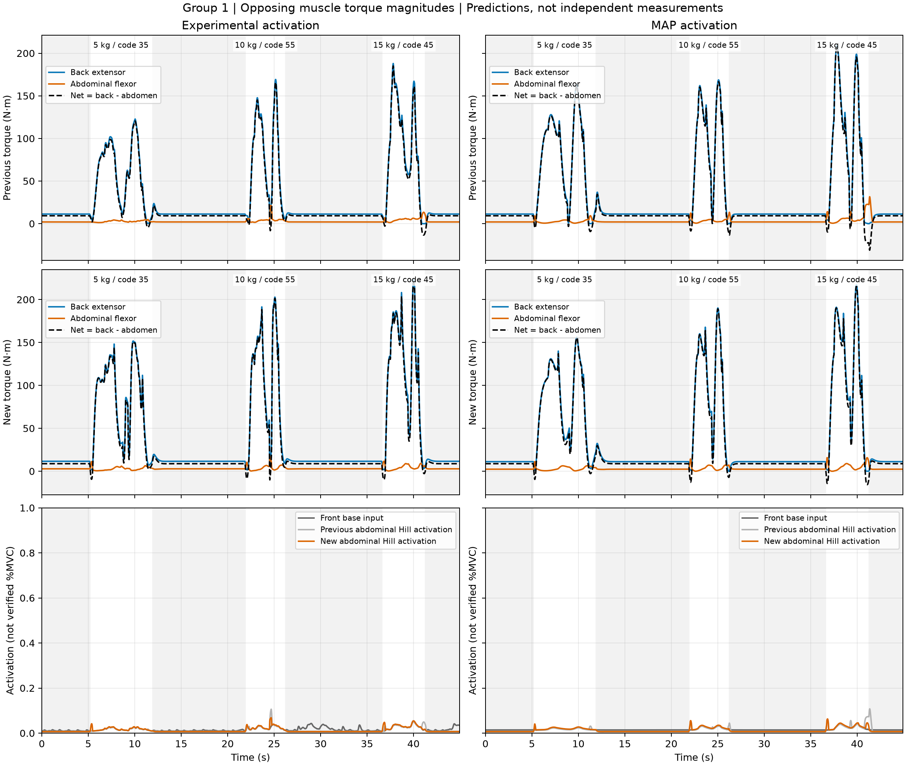
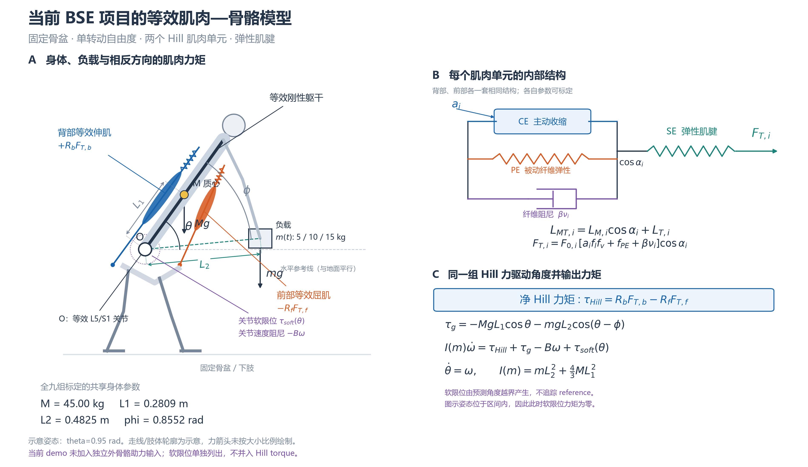
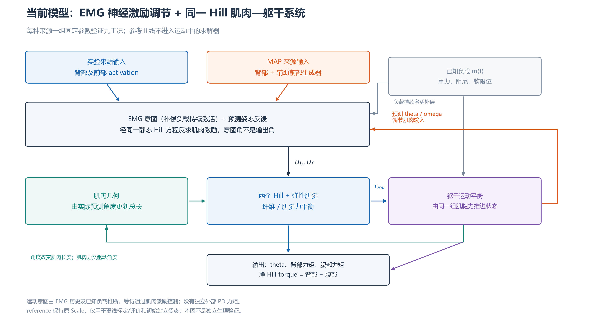
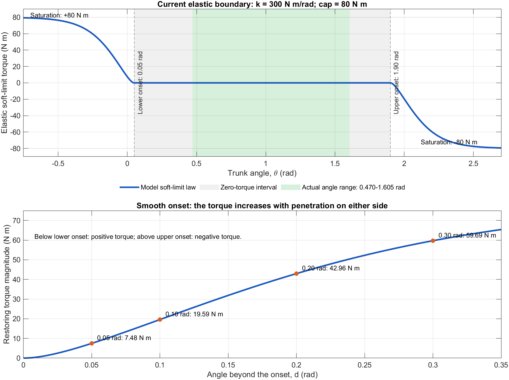
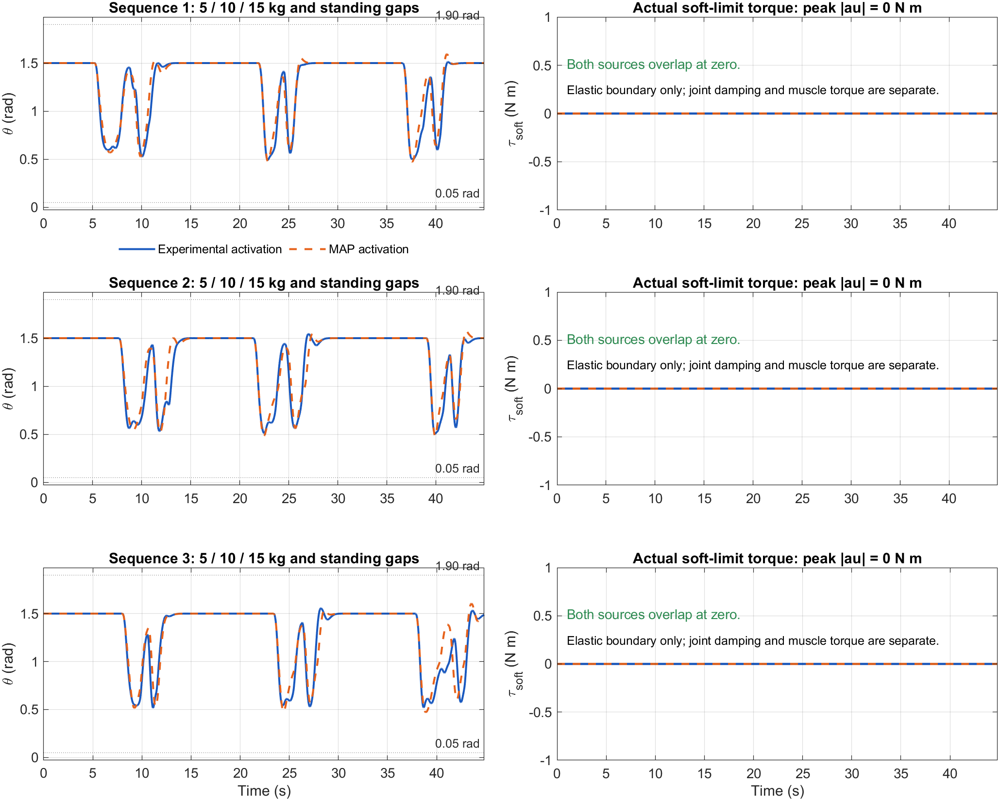
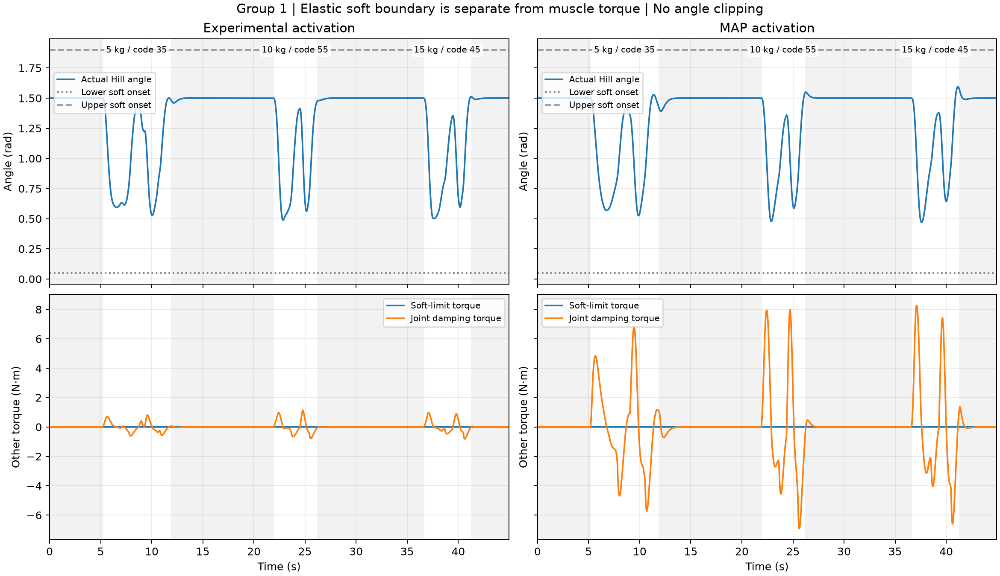

# 九工况固定参数的神经激励—Hill 模型

这轮修正了上一版“W 形存在、但弯腰谷值常停在约 0.9 rad”的问题。**实验来源的两个谷值现在均为 0.488–0.596 rad，MAP 为 0.470–0.654 rad**；中间起身也保留。theta 和 torque 仍由同一 Hill 系统产生，没有放大预测曲线或修改 reference。

实验来源与 MAP 来源各用一组固定参数，覆盖 5/10/15 kg × 原速度代码 35/45/55 的全部九工况；两种来源的模型结构一致，身体/负载几何和软限位共享。每组约 45 秒内连续完成三个负载动作和直立等待，动作之间不重置状态。当前每种来源为 **32 个物理/募集参数 + 10 个神经参数**，另有两来源共同使用的一组固定等待控制参数。

当前 `demo_hill_sequence` 默认选择这个版本，显式入口为 `demo_hill_neural`。本次选中的模型通过了角度形状、完整序列范围、腹部力矩、等待稳定及步长检查。**这是九工况联合标定后的回放检查，尚不能称为独立泛化验证或受试者真实肌肉力矩的测量。**

## 直接运行

在 MATLAB R2023b 中执行：

```matlab
cd('D:\matlab\Journal Paper of Upper-Limb Exoskeleton\GitHub_Ready');
demo_hill_sequence;
% 等效的显式入口：
% demo_hill_neural;
```

代码读取 [neural_models.mat](../data/processed/hill_compliant/neural_models.mat) 和已准备的完整实验记录，无需 Python、原始采集目录或重新训练。导出结果在 `results/hill_neural_sequence/`，包括三组 torque/theta 图、腹部力矩对比图、力矩分解、等待平衡图、逐帧 CSV 和完整 MAT。第一组的角度/净力矩图及腹部对比图会自动显示。

只计算第一组或暂不绘图：

```matlab
addpath('experiments/hill_compliant');
options = struct('modelFile', 'neural_models.mat', ...
                 'outputDirectory', 'hill_neural_sequence', ...
                 'groups', 1, 'renderFigures', false);
result = run_hill_sequence(pwd, options);
```

有已配置的 MATLAB C 编译器时，可运行 `build_hill_pair_accelerator` 编译三个求解入口。没有 MEX 时自动使用同方程的纯 MATLAB 求解器，连续模拟会明显较慢；Git 不提交平台编译产物。

## 结果与实际取舍

下表的均值均为**九个动作工况指标的算术平均**，前后使用相同记录和 reference；不包含等待段填入的 20 N·m。旧版是弯腰较浅的 `neural_models_shape_baseline.mat`，并非最早的大共同收缩 Hill 标定。

| 指标 | 浅弯腰旧版，实验 | 当前，实验 | 浅弯腰旧版，MAP | 当前，MAP |
| --- | ---: | ---: | ---: | ---: |
| 角度形状相关系数 | 0.775 | **0.798** | 0.799 | **0.825** |
| theta RMSE，° | 15.93 | **12.22** | 12.36 | **11.32** |
| 净 Hill torque RMSE，N·m | 41.66 | 42.28 | 40.90 | **39.59** |
| 背部平均力矩，N·m | 72.16 | **96.15** | 84.65 | **91.79** |
| 腹部平均力矩，N·m | 4.20 | **4.17** | 4.03 | **4.01** |
| 腹部/背部平均力矩比例，逐工况平均 | 5.85% | **4.36%** | 4.70% | **4.33%** |

当前角度保留了两个主要谷值及中间回升，未要求逐点幅值完全重合。实验来源最弱工况的形状相关系数为 0.700，MAP 为 0.678。两次下弯均最多比对应 reference 浅约 0.09/0.11 rad，允许更深的下弯。中间回升相对两个谷值的高度，最少达到 reference 的约 81%/96%。图中灰线是**上一版浅弯腰模型**；它不能被标成原始项目所有历史 BSE 中的最优版本。



| 完整三组序列检查 | 实验来源 | MAP 来源 |
| --- | ---: | ---: |
| 九工况各有两个主要谷值 | 9/9 | 9/9 |
| 完整序列角度范围，rad | 0.488–1.557 | 0.470–1.605 |
| 动作段背部峰值，N·m | 229.00 | 217.05 |
| 动作段腹部峰值，N·m | 35.67 | 17.40 |
| **含等待过渡的腹部峰值**，N·m | **35.67** | **17.40** |
| 含等待过渡的腹部 Hill activation 峰值 | 0.121 | 0.064 |
| 等待开始 2 s 后最大站立角误差，rad | 0.000175 | 0.000127 |
| 实际软限位力矩峰值，N·m | **0** | **0** |

腹部显示正的屈曲幅值，在净关节力矩中以负号相减。上述 activation 为模型内无量纲状态，**不是经过验证的 %MVC**。

九个工况的详细结果如下。每列来源内部始终使用同一个参数向量，表内没有逐工况再调参；每行两种来源均识别到两个主要谷值。主要谷值用 prominence=0.12 rad、最小间隔 0.5 s 检测。下表的深度按原 reference 中间起身两侧的相位区间分别取最小值，允许谷值时间小幅偏移。

| 负载 kg / 原速度代码 | 组 | 实验：谷 1 / 谷 2，rad | MAP：谷 1 / 谷 2，rad | 形状相关，实验/MAP | 净力矩 RMSE，实验/MAP，N·m |
| --- | ---: | ---: | ---: | ---: | ---: |
| 5 / 35 | 1 | 0.595 / 0.527 | 0.569 / 0.525 | 0.889 / 0.821 | 32.8 / 27.7 |
| 10 / 55 | 1 | 0.488 / 0.562 | 0.476 / 0.588 | 0.796 / 0.887 | 49.4 / 38.8 |
| 15 / 45 | 1 | 0.501 / 0.596 | 0.470 / 0.643 | 0.810 / 0.890 | 44.4 / 37.4 |
| 5 / 45 | 2 | 0.561 / 0.532 | 0.544 / 0.521 | 0.837 / 0.840 | 38.3 / 32.4 |
| 10 / 35 | 2 | 0.511 / 0.563 | 0.483 / 0.561 | 0.889 / 0.896 | 31.0 / 35.3 |
| 15 / 55 | 2 | 0.505 / 0.569 | 0.479 / 0.654 | 0.741 / 0.818 | 54.0 / 50.8 |
| 5 / 55 | 3 | 0.540 / 0.515 | 0.514 / 0.533 | 0.766 / 0.678 | 50.2 / 55.0 |
| 10 / 45 | 3 | 0.540 / 0.529 | 0.475 / 0.568 | 0.754 / 0.851 | 38.0 / 38.6 |
| 15 / 35 | 3 | 0.520 / 0.574 | 0.471 / 0.605 | 0.700 / 0.740 | 42.4 / 40.3 |



逐工况完整数据：[metrics.csv](hill_neural_evaluation/metrics.csv)。[固定参数审核](hill_neural_evaluation/fixed_parameter_audit.csv) 中，每种来源的九行都有完全相同的 **42 参数 SHA-256**，六项共同等待控制参数的散列也相同；完整 MATLAB 回放逐组核对了实际使用的向量。

## 为什么上一版弯得浅，本次怎样修正

只比较标准化后的角度形状，会丢掉幅度和偏移信息：谷值在 0.9 rad 的浅 W，也可以获得较高相关系数。上一版点对点角度项权重很小，最低摆幅要求只有 0.35 rad，所以优化能接受这样的浅弯腰；当时边界力矩实际为零，主要原因是目标函数的幅度退化。

本次增加两个相位谷值的深度项、中间起身的回升幅度项，以及较差工况的形状惩罚。谷值只与原参考相位的最小值宽松比较，未强制对准某一帧；角度逐点误差仍保持较小权重。姿态范围检查从 0–1.8 rad 放宽到 **−0.3–2.3 rad**，降低边界力矩的惩罚，允许小幅越界，不裁剪 theta。

还在意图解码中减去由已知负载和静态 Hill 模型估计的持续激活增量。这样持物时较高的背部输入不必全部被解释为继续下弯，中间起身可以更充分。此项只影响肌肉激励控制，原来源输入没有被改写，实际 theta/torque 仍由同一动态 Hill 系统计算。

## 腹部为何不再抵消大量背部力矩

最早的 `calibrated_models.mat` 主要通过背部输入及其历史推断前部募集，并用较大共同收缩兼顾角度与净力矩。净力矩虽然不大，内部背部/腹部力矩却可同时很大，单靠净 torque 和 theta 无法辨识这种抵消；该历史核查另见 [腹部募集报告](HILL_RECRUITMENT_AUDIT.zh-CN.md)。

本次保留原来源的腹部基础输入，惩罚额外推断募集、偏离基础输入的腹部 activation、无必要的两侧共同收缩及较大被动腹部作用。角度的绝对幅值权重降低，主要拟合标准化形状、变化方向、谷值和中间回升，避免用巨大腹部作用补偿每个角度误差。对肌肉容量也加入了宽松的工程先验，背部 F0=10000 N、前部 F0=3000 N 是正则化中心，**不是受试者独立测量或文献规定的标准数值**。

下图比较最近的浅弯腰版本与当前版本，两者均已减少早期的大共同收缩；当前在保留低腹部募集的同时加大了下弯幅度。



按**模型预测速度方向**和已知负载划分持物起身阶段，三个记录按该阶段样本数加权的背部/腹部平均力矩为：

| 持物起身 | 实验来源 | MAP 来源 |
| --- | ---: | ---: |
| 背部平均力矩 | 127.30 N·m | 125.86 N·m |
| 腹部平均力矩 | 4.12 N·m | 4.02 N·m |

这是模型分工的诊断，不是参考角度标记的实测相位。其他弯腰/起身、空载/持物阶段见 [phase_recruitment.csv](hill_neural_evaluation/phase_recruitment.csv)。腹部仍可参与制动、稳定和卸载后的姿态恢复，没有将腹部力矩事后截断为背部力矩的某个固定百分比。

直接放大原意图系数的初始候选虽能弯得更深，但部分中间起身不足，MAP 卸载后腹部峰值约 83 N·m。加入负载补偿、中间回升评价，并重新标定全部物理参数和共同等待控制后，当前版本同时通过深度、形状和完整过渡检查。不能只看动作中的低腹部峰值来选择模型。

## 同一模型怎样得到 theta 和 torque





theta 表示原项目定义的躯干对水平角；增大表示伸直。原 reference 不重新 rescale：动作段沿用原 0.5–1.4 rad Scale，原手写等待段保持 1.5 rad/20 N·m。等待的 20 N·m 是原填充值，不用于动作拟合。初始化采用原记录的站立角和初始速度，之后不读取 reference 角度。

### 输入端的运动意图与肌肉激励

令 `u_b` 为记录或 MAP 生成的背部输入，两个因果记忆满足：

$$
\dot z_f=(u_b-z_f)/0.06,\qquad
\dot z_s=(u_b-z_s)/0.25.
$$

$$
e=\operatorname{clip}_{[0,1]}
\left[u_b+T_{\rm lead}\frac{z_f-z_s}{0.25-0.06}
-\lambda\Delta u_{\rm tonic}(m)\right],
\qquad
\dot\theta_{\rm intent}
=\frac{\theta_s-Ae^\beta-\theta_{\rm intent}}{T_{\rm intent}}.
$$

其中

$$
\Delta u_{\rm tonic}(m)=\max\big(0,u_b^{stat}(\theta_s,m)-u_b^{stat}(\theta_s,0)\big).
$$

`u_b^stat` 使用同一静态 Hill/肌腱关系反求在固定站立角 θ_s 下抵抗重力所需的背部激励。这是模型估计的持续激活增量；λ 为标定增益，实验 0.500、MAP 0.763，不能当作受试者测得的神经比例。它不读取运动 reference，也不修改原输入矩阵。

**意图角是由 EMG 历史与已知负载推断的神经控制输入，不能当作预测 theta。** 实际 theta 仍是下述机械系统的状态。使用已经模拟出的 theta 和速度，计算肌肉净作用请求：

$$
\tau_r=-\tau_g(\theta,m)+K_p(\theta_{\rm intent}-\theta)-K_d\omega,
\qquad
\tau_d=
\begin{cases}
T_-\tanh(\tau_r/T_-),&\tau_r<0,\\
\tau_r,&\tau_r\geq0.
\end{cases}
$$

负方向饱和作用于**激励请求**，不会截断真实肌肉输出。令 P_b 为当前角度下零激活的背部静态 Hill 力矩，T_f^base 为腹部基础输入对应的静态 Hill 力矩，c 为小共同收缩请求：

$$
T_b^*=\max(P_b,\tau_d+T_f^{base})+c,\qquad
T_f^*=\max(T_f^{base},P_b-\tau_d)+c.
$$

在同一静态 Hill/肌腱平衡中反求这两个目标所需激励 `u_b*,u_f*`，再与原输入按固定系数 η 混合：

$$
u_i^{cmd}=(1-\eta)u_i^{input}+\eta u_i^*,
\qquad
\dot a_i=\big[(u_i^{cmd})^{\gamma_i}-a_i\big]/T_{a,i}.
$$

η 两来源均约为 0.700；全部十个神经参数见 [neural_parameters.csv](hill_neural_evaluation/neural_parameters.csv)。等待采用固定站立目标、Kp=80、Kd=30、Ki=0 的肌肉输入控制，100 ms 平滑切换；姿态修正请求上限 120 N·m、共同收缩请求 2 N·m。它们由完整记录中的回位误差和腹部制动共同筛选，两来源及全部九工况共享同一组设置；实际力矩仍经 Hill 动态产生。

因此当前模型包含神经控制假设，已经超出“将预处理 EMG 不加反馈地直接输入肌肉”的开环模型。Kp/Kd 调节肌肉激励，**没有另加一个关节 PD 力矩**。每帧 CSV 同时保留原输入、实际神经激励、有效 Hill activation 和意图角，便于检查这一假设的影响。

### 机械部分

背部 b 和腹部 f 都使用同样的 Hill、被动弹性、纤维阻尼和弹性肌腱形式：

$$
L_{MT,i}(\theta)=L_{MT,i}^{ref}-s_iR_i(\theta-1.4),
\quad s_b=+1,\ s_f=-1,
$$

$$
L_{MT,i}=L_{M,i}\cos\alpha_i+L_{T,i},
\qquad
F_{T,i}=F_{0,i}[a_i f_l f_v+f_{PE}+0.03\nu_i]\cos\alpha_i.
$$

其中 ν_i 是归一化纤维速度，肌腱只承受拉力；逐步求解纤维与肌腱的力平衡。肌腱的弹性关系为：

$$
F_{T,i}=F_{0,i}
\left[\max\left(0,\frac{L_{T,i}-L_{T,i}^{slack}}
{\epsilon_{T,i}L_{T,i}^{slack}}\right)\right]^2.
$$

同一组肌腱力既作为力矩输出，又驱动实际 theta：

$$
\tau_b=R_bF_{T,b},\quad \tau_f=R_fF_{T,f},
\quad \tau_{\rm Hill}=\tau_b-\tau_f,
$$

$$
\dot\theta=\omega,\qquad
I(m)\dot\omega=\tau_{\rm Hill}+\tau_g-B\omega+\tau_{\rm soft}(\theta),
$$

$$
I(m)=mL_2^2+\frac43ML_1^2,\qquad
\tau_g=-MgL_1\cos\theta-mgL_2\cos(\theta-\phi).
$$

**这里仍然进行同一肌肉—骨骼系统的耦合前向积分。** 没有先独立生成 theta，再拿 reference 或另一套逆动力学去生成 torque。每个 1 ms 子步使用隐式求解同时闭合肌肉长度、纤维/肌腱力和关节运动；输出 100 Hz。数值积分误差通过步长减半及 MATLAB/C 对照检查，不能用“未积分”来描述本模型。

## soft boundary 的设置和实际作用

保留你允许的弹性软限位，但放在宽范围之外，实际恢复力矩单独绘制。令：

$$
d_l=\max(\theta_l-\theta,0),\quad
d_u=\max(\theta-\theta_u,0),\quad
\psi(d)=d^2/(d+0.05),
$$

$$
\tau_{\rm soft}
=T_s\left[
\tanh\!\left(k_s\psi(d_l)/T_s\right)
-\tanh\!\left(k_s\psi(d_u)/T_s\right)
\right].
$$

| 共享设置 | 当前值 |
| --- | ---: |
| 下限起效角 θ_l | 0.05 rad |
| 上限起效角 θ_u | 1.90 rad |
| 弹性系数 k_s | 300 N·m/rad |
| 饱和上限 T_s | 80 N·m |

区间内部恢复力矩为零，越界后平滑起效；它是位置弹性项，关节速度阻尼 `−Bω` 另算。上述上限不是整段都有 80 N·m，也不是把角度截成 0.05–1.9 rad。当前六次完整回放和延长等待均没有越过起效角，实际软限位力矩为 **0 N·m**，因而没有靠边界弹力托住角度或制造主力矩。

这四项与其余 BSE 参数一样开放优化。最终回放没有激活边界，参数在弱先验下回到初始设置，不能称为由实验辨识出的关节限位刚度。**−0.3–2.3 rad 仅为宽松输出检查范围，不是截断规则**；本次无需触发边界也能获得较大的下弯幅度。

新图把完整的角度—恢复力矩关系与实际使用情况分开展示。特性曲线上的负角度及大于 1.90 rad 的角度用于展示越界后的限位规律，不是本次仿真轨迹。绿色区域为全部九工况、两种 activation 的实际角度范围 **0.470–1.605 rad**。



| 超出起效角的幅度 d，rad | 恢复力矩绝对值，N·m |
| ---: | ---: |
| 0.05 | 7.48 |
| 0.10 | 19.59 |
| 0.20 | 42.96 |
| 0.30 | 59.69 |

低于下限时力矩为正，高于上限时力矩为负，两侧大小对称。每个回放采样点都重新调用 `hill_soft_limit` 与已存储的 `boundaryTorque` 核对，最大差值为零。



在项目根目录运行 `demo_hill_soft_boundary` 即可重画上述两张图，输出 PNG/PDF 和 [越界力矩数值表](hill_neural_evaluation/soft_boundary_samples.csv)、[实际回放汇总](hill_neural_evaluation/soft_boundary_actual_summary.csv) 到 `results/hill_neural_sequence`。脚本读取当前模型与现有回放，不改参数；没有回放文件时，先用当前模型生成一次回放。



身体参数同样参与优化，两来源共享 M=44.99503 kg、L1=0.280885 m、L2=0.482493 m、φ=0.855222 rad。32 个物理/募集参数的值与边界见 [parameters.csv](hill_neural_evaluation/parameters.csv)；另有每种来源固定的十个神经参数。站立时净 Hill 力矩约为 **8.770 N·m**，用于平衡当前有效身体参数下的重力；红色 20 N·m 填充 reference 保持原样。

## 生理证据的用途和限制

研究支持常规提物时背部承担主要伸展作用、腹部可参与稳定：

- Refai 等（2025）在七名健康受试者提物实验中，报告腹部活动整体较低，风险条件间差异不显著，背部活动随条件变化。其模型同时使用实测运动学和 EMG，因此不能用于验证本 demo 仅从输入激活推断运动意图的方案。[原论文](https://www.frontiersin.org/journals/bioengineering-and-biotechnology/articles/10.3389/fbioe.2025.1486931/full)。
- Alemi 等（2022）的代表性记录中，初次弯腰的腹部活动小于 0.1 MVC，而持物起身部分背肌超过 0.6 MVC。这里是特定受试者、阶段的 EMG，不能换算成普适的腹部力矩上限。[作者接受稿，附录 B](https://vtechworks.lib.vt.edu/bitstreams/db15a377-f14f-42ca-9d93-c6c5df86e239/download)。
- van Dieën 等（2003）发现负载不稳定时腹部共同收缩与拮抗力矩增加，净关节力矩和角度却可以相近。这说明内部肌肉分配需要额外测量约束。[原研究摘要](https://research.vu.nl/en/publications/evidence-for-a-role-of-antagonistic-cocontraction-in-controlling-/)。

本次依据这些证据约束募集方向，没有把某个文献的 EMG 比例直接设成扭矩比例，也没有预设“背部 80%、腹部 20%”。目前约 4.3%–4.4% 是优化后的模型输出统计。

实验前部标签来自项目导出的 `Activations.sto` 中 `rect_abd_r`；其 MVC 校准没有得到确认。MAP 只直接生成背部输入，前部由已固定的辅助生成器补充，不是独立生成且测量验证过的腹部 EMG。两种输入不能被描述成两个都有完整独立腰腹 sEMG 的实验。

单自由度、两等效肌肉单元未独立建模腹内压或多节脊柱。肌肉容量、力臂、激活关系可互相补偿；当前 M 接近优化上界，激活响应时间约 5 ms，部分神经参数也靠近边界，说明参数仍有可辨识性限制。背部 F0 约为实验 22.30 kN、MAP 15.64 kN，是集中模型容量，不宜解释为某条真实背肌的测量值。**本轮改善了浅弯腰与中间起身问题，保持背部主导和稳定回位，尚未证明每一个有效参数都符合受试者解剖学。**

进一步验证应优先补齐同一受试者的腹部/背部 MVC、几何测量或独立保留的重复试次；预处理输入及动作/负载协议本身由完整实验记录离线准备，当前也不是完整在线动作识别系统。新版本没有重跑旧版速度留出标定，其九工况结果不能继承旧版的留出验证标签。

## 数值与复现审核

已经完成：

- 两来源各固定 42 参数，九个负载/速度组合逐一核对；共同身体/负载/软限位八参数完全一致，共同等待控制也逐项一致。
- 全部六次 MATLAB 连续回放与 C 优化求解器对照，最大 theta 差约 5.1×10⁻¹⁰ rad、净力矩差约 1.2×10⁻⁷ N·m。纯 MATLAB/C 对照包含持物阶段，核查负载补偿实际起效。
- 子步从 1 ms 减到 0.5 ms 后，最大角度差 0.00309 rad、力矩差 1.900 N·m。
- 原 reference 在完整回放中逐点一致；改变未来输入不会影响此前状态；外部平衡 PD 力矩为零。
- 每组原始记录后增加 30 秒无负载等待，不重置任何状态；末 10 秒站立角最大误差约 8.4×10⁻¹⁰ rad。整段没有使用软限位。

[筛选条件与结果](hill_neural_evaluation/screening.json)、[力平衡和步长检查](hill_neural_evaluation/numerical_checks.csv)、[完整 MATLAB 回放](hill_neural_evaluation/matlab_replay_checks.csv)、[延长等待](hill_neural_evaluation/extended_wait_checks.csv) 均随项目保存。筛选里的相关系数、范围及力矩阈值是 demo 的工程检查条件，不是医学或普适生理标准。

运行较短的 MATLAB 求解器/因果性检查：

```matlab
addpath('tests');
test_hill_neural;
```

需要重新生成旧/新对比快照或审核完整回放时，可用 Python（numpy/scipy；绘图另需 matplotlib）：

```powershell
python experiments/hill_compliant/evaluate_hill_physiology.py --model data/processed/hill_compliant/neural_models.mat --output hill_neural_selected_evaluation
python experiments/hill_compliant/check_hill_neural_sequence.py
python experiments/hill_compliant/draw_hill_neural.py
```

先运行 MATLAB demo，再执行完整回放审核；第一条直接使用随 Git 提交的便携参数，不依赖本地旧优化目录。Python 评价/审核调用 C 动态库：缺少编译产物时会用 GCC 构建，需配置 `gcc`。日常 MATLAB demo 不需要 Python 或 GCC。完整再训练工具是 [fit_hill_neural.py](../experiments/hill_compliant/fit_hill_neural.py)，可用 `--initial-model data/processed/hill_compliant/neural_models.mat` 从当前参数开始，采用分块有界最小二乘，耗时较长。

## 图表索引

[第 1 组 theta/torque](hill_neural_evaluation/torque_theta_group1.png) · [第 2 组](hill_neural_evaluation/torque_theta_group2.png) · [第 3 组](hill_neural_evaluation/torque_theta_group3.png)

[第 1 组旧/新背腹力矩](hill_neural_evaluation/muscle_recruitment_group1.png) · [第 2 组](hill_neural_evaluation/muscle_recruitment_group2.png) · [第 3 组](hill_neural_evaluation/muscle_recruitment_group3.png)

[第 1 组腹部力矩分解](hill_neural_evaluation/abdominal_components_group1.png) · [第 2 组](hill_neural_evaluation/abdominal_components_group2.png) · [第 3 组](hill_neural_evaluation/abdominal_components_group3.png)

[第 1 组两种来源腹部曲线同轴对比](hill_neural_evaluation/abdominal_torque_comparison_group1.png) · [第 2 组](hill_neural_evaluation/abdominal_torque_comparison_group2.png) · [第 3 组](hill_neural_evaluation/abdominal_torque_comparison_group3.png)

[第 1 组边界力矩](hill_neural_evaluation/soft_boundary_group1.png) · [第 2 组](hill_neural_evaluation/soft_boundary_group2.png) · [第 3 组](hill_neural_evaluation/soft_boundary_group3.png)

每张图旁均有同名 PDF。模型结构图另有中英文版本及可编辑 SVG。旧版高共同收缩的原因与诊断保留在 [历史腹部募集核查](HILL_RECRUITMENT_AUDIT.zh-CN.md)，原单段双 Hill 模型说明保留在 [历史基线报告](HILL_COMPLIANT.zh-CN.md)。

浅弯腰版本的参数保留在 `data/processed/hill_compliant/neural_models_shape_baseline.mat`，旧九参数解码器在新求解器中使用 λ=0 保持兼容。可以用 `run_hill_sequence` 的 `modelFile` 指向此文件、`outputDirectory` 设为独立目录来复现；不会覆盖当前参数。
