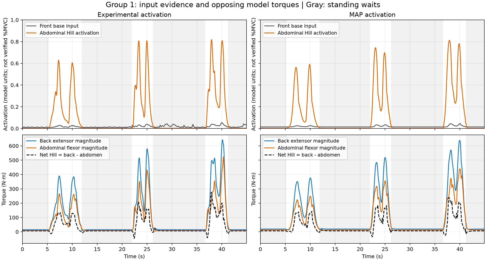
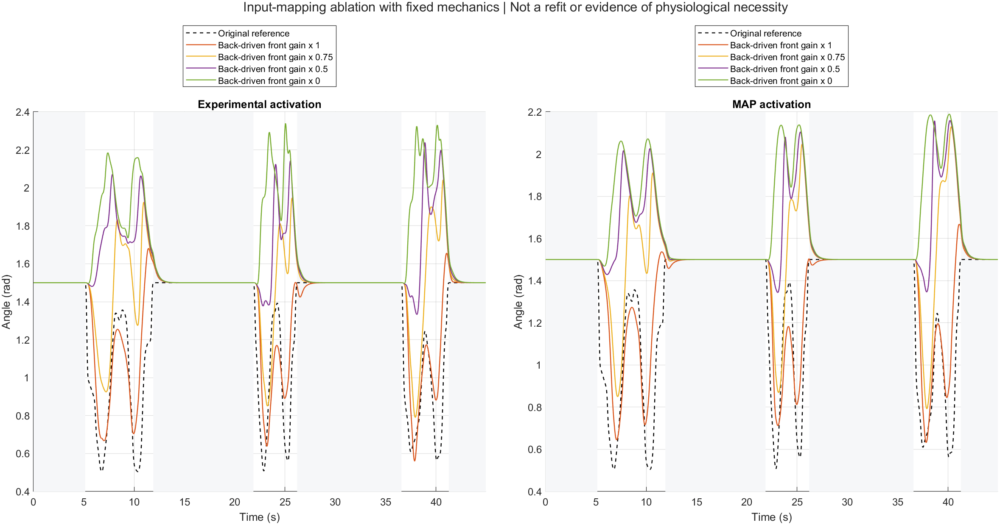

# 腹部激活与力矩的生理合理性核查

**版本范围：本报告核查历史 `calibrated_models.mat`，其中“当前模型”指被核查的旧标定。** 最新推荐版本使用 `neural_models.mat`，已重新约束募集，并以固定参数回放全部九工况，见 [最新结果、公式和限制](HILL_NEURAL.zh-CN.md)。本报告保留用于说明旧版问题，不代表新版的肌肉力矩。

**核查结论：目前没有独立证据支持模型给出的高腹部 activation 和 403–522 N·m 腹部峰值力矩是该受试者实际所需。当前标定在腹部募集方面未通过生理合理性核查，不能用作真实肌肉分工的结论。**

背部和腹部力矩重新放在同一坐标轴后，背部的平均力矩和峰值仍然更大；问题是模型产生了大量相互抵消的肌肉作用，且腹部活动主要由背部输入推算。此核查保留原模型、原 reference 和已标定参数，新增诊断与输入映射削弱试验，没有把诊断结果冒充为新的生理标定。

## 研究证据

1. **Refai 等，2025，Frontiers in Bioengineering and Biotechnology。** 7 名健康男性进行 20/21 kg 提物，比较三种 NIOSH 风险条件，分别采集背部伸肌和腹直肌 sEMG 并进行 iMVC 归一化。作者报告腹部活动总体较低，三种条件之间没有显著差异；背部伸肌活动则随条件发生变化。其方法将实测运动学与 EMG 输入肌骨模型，并非只靠 EMG 前向预测角度，因此不能直接视为本项目角度预测方法的验证。样本较小，也不是本项目受试者。[全文](https://www.frontiersin.org/journals/bioengineering-and-biotechnology/articles/10.3389/fbioe.2025.1486931/full)。

2. **Alemi、Simon、Geissinger 与 Asbeck，2022，Journal of Applied Physiology。** 背部支撑外骨骼研究的附录展示两名受试者的代表性 EMG：初次下弯阶段腹部活动小于 0.1 MVC，部分背部肌肉约 0.1–0.2 MVC；持物起身时部分背肌超过 0.6 MVC，腹部主要在起身开始时有少量活动。这些是特定阶段和记录的结果，不能设成所有人、所有负载的统一 10% 上限。论文也讨论了过强外骨骼伸展助力使腹部被迫对抗的情形。[作者接受稿，附录 B，PDF 第 29–30 页](https://vtechworks.lib.vt.edu/bitstreams/db15a377-f14f-42ca-9d93-c6c5df86e239/download)；[大学存档及出版信息](https://vtechworks.lib.vt.edu/items/3d12c476-629b-4051-9f1a-19f0339ccd15)。

3. **van Dieën、Kingma 与 van der Burg，2003，Journal of Biomechanics。** 10 名健康男性提起装水或装冰的容器。负载不稳定时，腹部共同收缩和模型估计的拮抗屈曲力矩增加，但净 L5/S1 力矩和躯干运动没有相应显著改变。研究支持腹部共同收缩具有稳定作用，也说明单看净关节力矩和角度不能辨识内部共同收缩。[作者所在大学的论文摘要](https://research.vu.nl/en/publications/evidence-for-a-role-of-antagonistic-cocontraction-in-controlling-/)。

这些证据支持“常规提物中背部承担主要伸展作用，腹部可以参与稳定”的解释，不能推出腹部完全不工作，也不能给出普适的背部/腹部力矩比例。腹部 EMG 也不能直接换算为腹部 N·m；还需要肌肉容量、几何、力长/力速关系等。本项目没有独立模拟腹内压机制，将全部前部作用集中成一个屈肌单元，本身也是解剖解释的限制。

## 当前模型的实际输出

以下只统计动作段，排除原协议中的直立等待。均值按动作样本数加权；两来源采用同一 Hill 方程，肌肉参数分别标定。腹部力矩为正的屈曲幅值，在净关节作用中以负号相减：

$$
\tau_{\mathrm{Hill}}=\tau_{\mathrm{back}}-\tau_{\mathrm{abd}}.
$$

| 第 1 组连续 5→10→15 kg | 实验来源 activation | MAP 来源 activation |
| --- | ---: | ---: |
| 募集前腹部输入均值 | 0.0219 | 0.0220 |
| 腹部有效 Hill activation 均值 | 0.3028 | 0.3029 |
| 腹部有效 Hill activation 峰值 | 0.8185 | 0.8118 |
| 背部力矩均值 | 248.00 N·m | 257.91 N·m |
| 腹部力矩均值 | 170.11 N·m | 181.54 N·m |
| 背部力矩峰值 | 642.68 N·m | 637.70 N·m |
| 腹部力矩峰值 | 522.29 N·m | 439.49 N·m |
| 腹部/背部平均力矩比 | 68.6% | 70.4% |
| 腹部募集信号 S 中背部及其历史的贡献 | 97.08% | 99.83% |

三组共六条预测中，腹部有效 activation 峰值为 **0.733–0.866**，平均力矩为 **161–194 N·m**，峰值为 **403–522 N·m**；腹部/背部平均力矩比为 **65.3%–72.1%**。该比例是均值之比，不是逐帧比例的均值。腹部力矩仅在约 11%–13% 的动作帧超过背部，不能概括为腹部力矩一直大于背部。

大腹部力矩也不是被动弹簧或阻尼被误标为腹肌：动作段腹部主动 CE 平均力矩约占总腹部均值的 **98%–99%**，被动 PE 均值仅约 1.1–3.1 N·m。第 1 组实验来源腹部峰值 522.29 N·m 中，主动 CE 为 520.22 N·m，此时 PE 为零。软限位是另外单独记录的关节项。



[第 2 组](hill_recruitment_audit/recruitment_summary_group2.png) · [第 3 组](hill_recruitment_audit/recruitment_summary_group3.png) · [六条预测的完整指标](hill_recruitment_audit/recruitment_metrics.csv) · [主动/被动力矩核查](hill_recruitment_audit/component_diagnostics.csv)。

## 为什么模型生成了高腹部活动

当前募集映射为：

$$
d(t)=\mathrm{LP}_{0.10s}[u_b]-\mathrm{LP}_{0.35s}[u_b],
$$

$$
S=g_f u_{f,\mathrm{base}}+g_b u_b+g_{\uparrow}\max(d,0)
  +g_{\downarrow}\max(-d,0),\qquad u_f=1-\exp[-\max(S,0)].
$$

随后，映射后的激励经过有效 activation 动态进入 Hill：

$$
\dot a_f=\frac{u_f^{\gamma_f}-a_f}{T_{a,f}}.
$$

连续序列还会在等待时混入肌肉激励端的姿态调节。因此原腹部输入、映射后激励、有效 Hill activation 是不同的量。

| 当前参数 | 实验来源 | MAP 来源 | 原优化范围 |
| --- | ---: | ---: | --- |
| 腹部容量 $R_fF_{0,f}$ | 999.90 N·m | 1000.00 N·m | 20–1000 N·m |
| 腹部原输入增益 $g_f$ | 0.9353 | 0.0500 | 0.05–5 |
| 背部共同收缩增益 $g_b$ | 1.5000 | 1.4426 | 0–1.5 |
| 背部上升历史增益 $g_\uparrow$ | 7.7897 | 5.6261 | 0–15 |
| 背部下降历史增益 $g_\downarrow$ | 0.7586 | 1.1023 | 0–15 |

两来源的腹部容量都到达或接近上界，MAP 的腹部原输入增益接近下界。募集信号 S 中来自背部及其历史的贡献为实验 **96.7%–97.1%**、MAP **约 99.8%**。这衡量的是饱和映射前信号 S 的来源，不能解释为真实腹部 EMG 或肌肉力的百分比。

原项目的背部输入是多个背肌 activation 的加权组合，实验来源前部输入则取 `Activations.sto` 中的 `rect_abd_r`。这个文件是原处理流程导出的 activation，并不是未经处理的腹部 EMG 通道。本次没有核实其 MVC 归一化标定关系；MAP 前部基础输入也是由辅助生成器估计，MAP 本体没有独立预测腹肌 EMG。因此 **a=0.8 不能直接写成受试者使用了 80% MVC**，也不能把 0.022 与论文的 2.2% MVC 直接等同。

数学上，只观测 $\tau_{\mathrm{back}}-\tau_{\mathrm{abd}}$，同时增大两侧力矩可能仍保持净力矩近似不变。角度对内部状态会增加约束，但不能代替独立腹部测量。这里“高容量 + 高背部驱动募集”让优化器通过较大的对抗作用获得运动拟合。它是当前标定方案的补偿机制，不能据此认定人体需要相同的共同收缩。

## 削弱募集映射的验证

新脚本将 $g_b,g_\uparrow,g_\downarrow$ 同时乘以 1、0.75、0.5、0，保持其余参数、负载、原 reference、等待控制和 Hill 方程不变，共回放三组 × 两来源 × 四个设置。角度没有截断，也没有重新拟合参数。

| 第 1 组实验来源 | 原映射 | 背部驱动腹部增益 ×0 |
| --- | ---: | ---: |
| 动作段 theta RMSE | 16.51° | 62.51° |
| 全序列最大 theta | 1.681 rad | 2.339 rad |
| 软限位力矩绝对峰值 | 31.83 N·m | 145.46 N·m |

24 条回放均返回有限数值，但削弱映射后的角度明显偏离，部分超过用户接受的约 0–1.8 rad，且软限位作用增大。MAP 在关闭背部驱动腹部募集后，腹部总力矩均值甚至可能增大，因为姿态和被动张力也会改变。不能仅看输入增益下降，就假设腹部总力矩必定下降。

**这个试验只证明当前参数依赖该补偿，不能证明真实人体必需这么大的腹部作用。** 要降低多余共同收缩，需要重新联合标定力矩容量、几何、输入映射和其余相关参数，不能只将腹部曲线乘以某个系数。



[全部反事实回放指标](hill_recruitment_audit/counterfactual_metrics.csv)；[完整募集来源图](hill_recruitment_audit/recruitment_audit_group1.png)。

## 重新标定应增加的证据与目标

保留两来源的同一模型结构、原角度 Scale、软限位及全部 32 参数的优化资格，但需要把内部肌肉分配纳入约束：

- 核实腹部与背部的 EMG 通道、MVC 标定和 activation 处理链；有独立腹部信号时，以它约束腹部募集，避免背部历史项淹没腹部原输入。MAP 的腹部生成器需单独检查，并保留训练/验证分离。
- 给容量、力臂和肌肉长度加入来源明确的受试者先验，并检查参数触边。开放优化不等于参数必须不受生理约束；实验与 MAP 的肌肉映射可以分别标定，身体/负载几何仍共享。
- 在 theta、净 torque、W 的峰谷/时序目标以外，对无测量支持的额外共同收缩增加软惩罚，例如归一化后的 $\min(\tau_b,\tau_f)$ 或总肌肉作用。惩罚权重需验证，不能把背部/腹部固定成 80/20，也不能把论文中的 10% MVC 当作通用上限。
- 用负载或速度留出检查内部力矩、输入映射与角度趋势。同步监测被动和软限位力矩，避免把原先的腹部补偿转移到被动张力或边界恢复项。

这次完成的是证据核查及诊断，不是新的腹部生理参数标定。由于缺少独立的腹部力矩和已核实的 MVC 对应关系，不能给出该受试者“实际应该产生多少 N·m”的可靠唯一答案。

## 运行与复现

在 MATLAB 项目根目录运行：

```matlab
cd('D:\matlab\Journal Paper of Upper-Limb Exoskeleton\GitHub_Ready');
demo_hill_recruitment_audit;
```

脚本读取 `results/hill_sequence/hill_sequence.mat`，缺少时先生成连续序列；随后绘制三组诊断图和映射削弱图。结果写入 `results/hill_recruitment_audit/`，包括 MAT、FIG、PNG、PDF、六份逐帧 CSV 及三张指标表。使用纯 MATLAB 求解器时会比 MEX 慢。

将核查后的快照导出到可提交 GitHub 的 `docs/hill_recruitment_audit/`：

```powershell
python experiments/hill_compliant/export_hill_recruitment_audit.py
```

导出器独立重建两来源腹部基础输入和募集映射，检查缓存与当前模型一致、力矩单位/符号/分解、六条预测指标以及 24 条角度回放；另生成本文的简洁对比图与文件哈希。数值核查通过不等于生理合理性通过。
