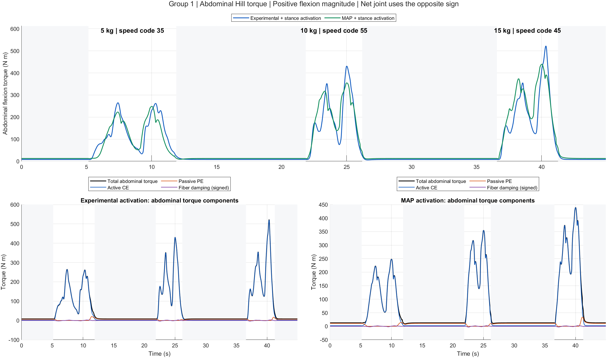
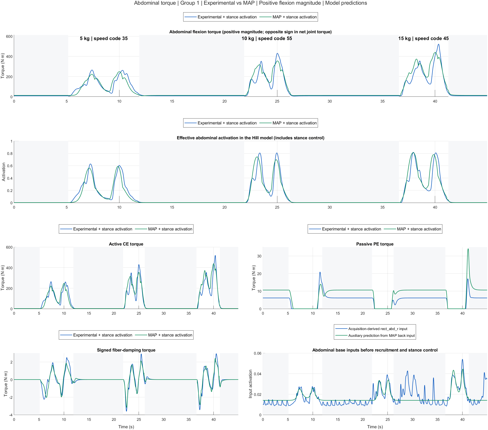
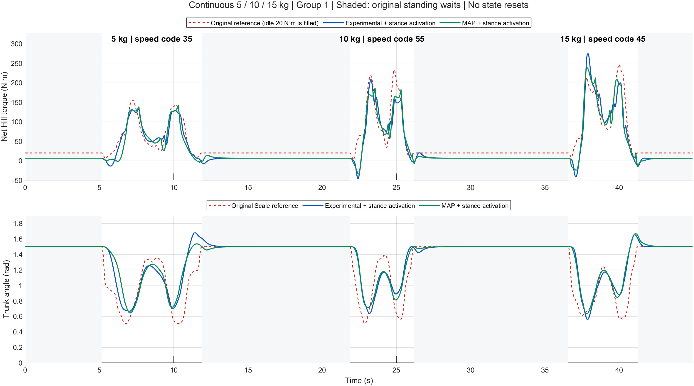

# 连续 5 / 10 / 15 kg 动作、直立等待与腹部力矩

**版本范围：本报告记录原连续实验协议和历史 `calibrated_models.mat` 的结果。** `demo_hill_sequence` 现在默认选择新的 `neural_models.mat`，输出到 `results/hill_neural_sequence/`，最新公式、参数和图表见 [九工况固定参数报告](HILL_NEURAL.zh-CN.md)。下文的旧参数、约 6.54 N·m 站立力矩和高腹部力矩不代表新版；新版站立净力矩约 8.770 N·m，等待控制参数从当前模型文件读取。

要复现下文旧结果，显式运行：

```matlab
addpath('experiments/hill_compliant');
run_hill_sequence(pwd, struct('modelFile', 'calibrated_models.mat', ...
                             'outputDirectory', 'hill_sequence'));
```

**腹部募集核查未通过生理合理性验证。** 当前动作段腹部平均力矩抵消约 65%–72% 的背部力矩，募集映射主要由背部输入驱动。下列输出是当前模型的预测，不能当成受试者真实腹部力矩。[文献、同轴对比、参数核查与削弱映射回放](HILL_RECRUITMENT_AUDIT.zh-CN.md)；复现入口为 `demo_hill_recruitment_audit`。

连续入口：`demo_hill_sequence.m`。它按原实验的时间顺序连续模拟三个负载动作，保留动作前、中间和结束后的直立等待。下文描述旧版本，两种来源沿用旧参数；模型在负载变化时均不重置状态。

## 直接运行

在 MATLAB R2023b 中运行：

```matlab
cd('D:\matlab\Journal Paper of Upper-Limb Exoskeleton\GitHub_Ready');
demo_hill_sequence;
```

默认计算三组约 45 秒的记录、两种 activation，以及关闭等待控制的对照，共 12 次连续回放。生成全部图表并显示第一组的综合对比和腹部力矩。已准备的 MAT 数据包含完整等待段，运行时无需原始采集目录、Python 或重新标定。

如果只想看第一组：

```matlab
addpath('experiments/hill_compliant');
sequenceResults = run_hill_sequence(pwd, struct('groups', 1, ...
    'modelFile', 'calibrated_models.mat', 'outputDirectory', 'hill_sequence'));
```

默认优先使用本地 MEX；没有 MEX 时自动使用同一方程的纯 MATLAB 实现，速度会明显较慢。已配置 C 编译器时可运行 `build_hill_pair_accelerator`，它会编译单段、旧连续模型和新神经/Hill 模型三个求解入口。编译产物不提交 Git。

| 输出：`results/hill_sequence/` | 内容 |
| --- | --- |
| `torque_theta_group1.png/pdf/fig` | 两行图：净 Hill torque、theta；两种来源对同一 reference |
| `abdominal_torque_group1.png/pdf/fig` | 腹部屈曲力矩及主动 CE、被动 PE、纤维阻尼力矩，单位 N·m |
| `abdominal_torque_comparison_group1.png/pdf/fig/csv` | 两种来源在相同坐标轴上的腹部力矩、Hill activation、各力矩分量及原腹部输入 |
| `sequence_group1.png/pdf/fig` | 完整综合图：torque、theta、activation、其他力矩 |
| `standing_balance_group1.png/pdf` | 开启/关闭等待控制的角度，及实际神经激励指令 |
| `group1_source1.csv` / `group1_source2.csv` | 每帧状态、力矩、activation、肌肉力；source 1 为实验，2 为 MAP |
| `movement_metrics.csv` | 仅动作段的 theta、torque 拟合误差与谷值数量 |
| `waiting_metrics.csv` | 等待平衡误差、角度范围、外部平衡力矩为零的检查 |
| `muscle_torque_metrics.csv` | 腹部力矩峰值/均值、各力矩分量、带符号的关节贡献和分解残差，单位 N·m |
| `hill_sequence.mat` | 三组完整输入、模型、预测、对照及指标 |

第二、三组的文件名分别使用 `group2`、`group3`。已检查的 PNG/PDF 和指标快照在 [hill_sequence_evaluation](hill_sequence_evaluation/)；可随 GitHub 项目一起提交。FIG 和逐帧 CSV 留在本地 `results/`，可重新生成。

## 串联怎样保留原实验

直接读取三份原始 `Combination_raw.mat` 的完整记录，每 10 个原始样本取一个样本，输出 100 Hz。未重新 rescale、平滑 reference、删接缝、拉伸时间或拼接重复的单段预测。三组均为 5→10→15 kg：

| 组 | 原文件标识 | 总时长 | 5 kg 动作段 | 10 kg 动作段 | 15 kg 动作段 |
| --- | --- | --- | --- | --- | --- |
| 1 | `5_35_10_55_15_45` | 44.95 s | 5.15–11.89 s | 21.87–26.19 s | 36.58–41.26 s |
| 2 | `5_45_10_35_15_55` | 44.93 s | 7.63–13.53 s | 21.34–27.63 s | 38.98–43.03 s |
| 3 | `5_55_10_45_15_35` | 44.84 s | 7.96–12.51 s | 23.36–28.66 s | 37.79–43.94 s |

35、45、55 是原项目的速度代码；没有将其改称为参考图片中的 BPM。动作/等待时间按完整记录的背部输入非零区间离线恢复，作为已知实验协议传给模拟器，不由预测角度决定。这一协议准备过程不是实时动作识别器。

角度 reference **保持你原代码的 Scale**。动作段原 `normalize_max_min` 的目标范围为 0.5–1.4 rad；原手写拼接代码在等待段填入了 **1.5 rad、20 N·m、背部 activation=0**。这些等待值也原样保留，逐点审核差异为零。因此完整序列的 reference 不是重新缩放的 0.5–1.4 rad，也不是人为改成 π/2；站立目标 1.5 rad 从原记录开始的一秒取得。

等待段的 20 N·m 是原代码填充值，不能视为独立测得的站立力矩。当前身体参数在 1.5 rad、未持负载时产生约 **6.536 N·m** 重力矩，稳定站立的净 Hill 力矩因此约为 6.54 N·m。图上保留红色 20 N·m reference，但不把这一填充值纳入动作拟合误差或强迫模型追踪它。

负载按原拾取/放下窗口启用，80 ms 因果一阶过渡；等待时有效持物质量趋近于零，身体质量不变。每个来源在整组 45 秒中仅初始化一次，角度、速度、两条肌肉的 activation 和纤维长度、输入滤波记忆全部延续，负载变化时不换模型参数。

## 等待怎样保持平衡

参考了你 GitHub 项目中 [Torque_function_constant.m](https://github.com/JOOHAANN/MPC-for-upper-limb-exoskeleton/blob/main/src/workflows/training_map__muscle_tendon__general_model_op_scale/Torque_function_constant.m)：旧代码在 activation 小于 0.05 时，用 Kp=200、Kd=80、Ki=0 直接加外部姿态平衡力矩。

本次将姿态调节放在 **Hill 肌肉的神经激励输入端**。控制器给出所需肌肉作用，再通过当前肌肉几何反求激励；真实力仍由同一 Hill 纤维/肌腱平衡和 activation 动态算出。独立外部 PD 平衡力矩始终为零。重力、关节阻尼、已允许的软限位仍单独列出。

令原记录的站立目标 θs=1.5 rad，当前预测角度为 θ、速度为 ω：

$$
e=\theta_s-\theta,\qquad
\tau_{post}=120\tanh\!\left(\frac{200e-60\omega}{120}\right),
$$

$$
\tau_g=-MgL_1\cos\theta-m(t)gL_2\cos(\theta-\phi),\qquad
\tau_{req}=-\tau_g+\tau_{post}.
$$

Kp=200 N·m/rad、Kd=60 N·m·s/rad、Ki=0；120 N·m 是**姿态修正请求的饱和上限**，不是额外施加的边界弹力。实际肌肉作用受到 0–1 激励范围、肌肉容量、力长/力速关系和激活延迟限制，不保证瞬间达到请求值。

用当前角度下两条肌肉零 activation 的静态平衡力矩 τb,min、τf,min，先分配期望背部/腹部拉力矩：

$$
D=\tau_{req}-(\tau_{b,min}-\tau_{f,min}),
$$

$$
\tau_{b,req}=\tau_{b,min}+c+\max(D,0),\qquad
\tau_{f,req}=\tau_{f,min}+c+\max(-D,0),\qquad c=2\ {\rm N\,m}.
$$

c 是两侧相同的共同收缩余量，净作用相互抵消。按期望 τ/R 得到肌腱张力、反算肌腱伸长和当前纤维长度，再由静态 Hill 平衡反算有效 activation：

$$
a_{req}=
\operatorname{clip}_{[0,1]}
\left[\frac{F_{T,req}/(F_0\cos\alpha)-f_{PE}(\ell)}
{f_l(\ell)}\right],\qquad
u_{post}=a_{req}^{1/\gamma}.
$$

静态反解仅用于产生指令。动态预测仍使用原 Hill 模型和有效激活动态：

$$
u=(1-\lambda)u_{base}+\lambda u_{post},\qquad
\dot\lambda=(w-\lambda)/0.15,\qquad
\dot a=(u^\gamma-a)/T_a.
$$

w 是已知协议的等待标志，等待为 1、动作为 0；λ 用 150 ms 过渡。动作开始后姿态作用平滑衰减，不会瞬间清空控制或激活状态。`standing_balance` 图显示原输入、加入姿态控制后的指令以及开启/关闭控制的结果。新增等待激励是模型估计的姿态控制，不是实验实测的等待 EMG。

**theta 仍通过同一 Hill 系统的耦合前向动力学求解**：

$$
\tau_{Hill}=R_bF_{T,b}-R_fF_{T,f},\qquad
I(m)\dot\omega=\tau_{Hill}+\tau_g-B\omega+\tau_{soft}(\theta),\qquad
\dot\theta=\omega.
$$

没有独立生成角度再倒算 torque；也没有把 θ 锁定或截断到某个范围。若要求完全不积分运动方程，需要另行采用准静态假设，不能把当前方法称为不积分的模型。完整 Hill、肌腱、几何、软限位公式见 [原模型说明](HILL_COMPLIANT.zh-CN.md)。

本次沿用已联合标定的 32 参数，两种来源共享 M=29.1977 kg、L1=0.32259 m、L2=0.79474 m、φ=0.46440 rad，以及相同软限位。没有为了每个新负载另行更换 M、L 或肌肉参数。这里新增的是连续协议和等待激励调节，未重新运行模型拟合。

## 腹部肌肉力矩怎样计算

腹部使用当前模型的集中前部屈肌 Hill 单元，和背部伸肌作用方向相反。当前腹部图表统一使用 **torque，单位 N·m**。肌腱力乘以该来源的腹部力臂得到腹部屈曲力矩：

$$
\tau_{\mathrm{abd}}=R_f F_{T,f}
=R_f F_0\left[a_f f_l(\ell_f)f_v(\nu_f)+f_{PE}(\ell_f)+0.03\nu_f\right]\cos\alpha_f.
$$

图直接读取同一 Hill 求解器已经计算好的 `frontTorque`，没有把 N 曲线仅改成 N·m 标签，也没有使用 reference torque 生成腹部力矩。实验来源 Rf≈0.07542 m，MAP 来源 Rf=0.08000 m；两种来源分别使用自己的已标定力臂。

图中采用 **正的腹部屈曲力矩幅值**；在当前“躯干角度增加为正”的关节坐标中，腹部贡献为负：

$$
\tau_{\mathrm{joint,abd}}=-\tau_{\mathrm{abd}},\qquad
\tau_{\mathrm{Hill}}=\tau_{\mathrm{back}}-\tau_{\mathrm{abd}}.
$$

背部和腹部力矩不能直接相加。CSV 同时保存正的腹部力矩和负的关节贡献，列名分别为 `abdominalFlexionTorqueNm`、`abdominalJointContributionNm`。两来源对比 CSV 的相应列带 `experimental` / `map` 前缀。

主动 CE、被动 PE、纤维阻尼也使用求解器的 N·m 输出，包含力臂和羽状角投影；逐帧满足：

$$
\tau_{\mathrm{abd}}
=\tau_{\mathrm{CE,abd}}+\tau_{\mathrm{PE,abd}}+\tau_{\mathrm{D,abd}}.
$$

纤维阻尼分量可以为负；总腹部屈曲力矩不为负。软限位、重力和关节速度阻尼是其他关节项，单独列出，没有混入腹部肌肉力矩。

| 腹部屈曲力矩峰值 | 实验 activation | MAP activation |
| --- | --- | --- |
| 第 1 组 | 522.29 N·m | 439.49 N·m |
| 第 2 组 | 444.29 N·m | 403.17 N·m |
| 第 3 组 | 403.15 N·m | 403.50 N·m |

允许动作结束后 2 s 收敛后，直立等待的平均腹部屈曲力矩约为实验 **8.26 N·m**、MAP **12.67 N·m**。这是腹部单元的作用，和等待时约 6.54 N·m 的净 Hill 力矩是不同的量。

这些是集中模型的预测力矩，未做单条腹肌的独立生理验证。实验前部输入来源为 `rect_abd_r`，但经过募集映射和容量标定后，输出对应集中腹部单元。两侧较大的对抗力矩可能相互抵消，因此净力矩拟合不能独立验证共同收缩大小。肌肉容量、力臂和募集仍需结合独立测量约束。



### 腹部 torque 直接对比

`abdominal_torque_comparison_group*.png` 将实验与 MAP 来源叠加在同一坐标轴，便于比较幅值、峰谷和时序。蓝线为实验来源，绿线为 MAP 来源；灰色背景为原直立等待段。

图中依次显示腹部屈曲力矩、实际进入 Hill 的有效 activation、主动 CE 力矩、被动 PE 力矩、纤维阻尼力矩，以及募集映射/姿态控制前的腹部输入。底部实验来源输入取自原处理流程 `Activations.sto` 的 `rect_abd_r` activation；其 MVC 对应关系尚未核实，不能直接解释为归一化实测腹部 EMG。另一条为由 MAP 背部输入辅助生成的腹部 activation；MAP 没有直接输出独立腹肌 EMG。

这份对比没有独立腹部 torque 的测量 reference，因此两条力矩曲线均标为模型预测。总关节 reference 属于背部/腹部等项合成后的量，不当作腹部单元的 reference。力矩面板统一为 N·m，activation 面板无量纲；被动及阻尼力矩使用各自纵轴。



[第2组力矩对比](hill_sequence_evaluation/abdominal_torque_comparison_group2.png) · [第3组力矩对比](hill_sequence_evaluation/abdominal_torque_comparison_group3.png)。三组均导出 PNG、PDF、FIG 和逐点 CSV；`demo_hill_sequence` 默认显示第1组新力矩对比图。

辅助数值检查仍保存肌腱力 N，用于核对 `tau=R*F` 与肌腱力平衡；当前腹部展示以力矩 N·m 为准。此前力图快照已移入本地 `results/hill_sequence/legacy_force_figures/`。

## 实际结果与检查

九个动作条件逐条件 RMSE 的均值：

| 输入来源 | theta RMSE | 净 Hill torque RMSE | 两个主要谷值 |
| --- | --- | --- | --- |
| 实验 activation | 15.05° | 33.92 N·m | 9/9 |
| MAP activation | 14.63° | 34.96 N·m | 9/9 |

两个主要谷值仅表示突出度 ≥0.12 rad、间距 ≥0.5 s 的谷值数量一致，不保证 W 的峰谷深度和时序完全吻合。本次是使用全九条件参数的**连续标定回放**，不是新增的独立泛化测试。原有整组速度留出结果仍在 `demo_hill_compliant` 中。

六条连续预测的角度总范围为 **0.442–1.736 rad**，未截断；允许动作结束后 2 s 收敛后，等待段最大偏差为 **0.00423 rad（约 0.242°）**。当前上限软恢复项实际峰值为实验 31.83 / MAP 53.22 N·m，等待目标 1.5 rad 在软限位区间内，稳定等待不靠边界弹簧托住。

已通过：

- 三组完整 reference 与原 MAT 逐点相等。
- Hill 力矩、CE/PE/纤维阻尼分解、关节运动平衡一致；外部姿态平衡力矩为零。
- 腹部力矩独立按肌腱应变与力臂重算，并检查分解与关节作用符号；最大力矩分解误差小于 0.0000001 N·m。
- 动作/等待与负载切换时无状态重置，activation 连续。
- 给定协议时，改变未来输入不影响过去预测；reference 曲线不进入动作输入映射。
- 1 ms 步长减半为 0.5 ms 时，最大差异为 0.001029 rad、0.541 N·m。
- 每条序列再追加 30 s 未持物等待，总时长约 75 s，没有持续旋转；最后 10 s 稳定收敛。
- 连续序列 C/MEX 与可读 MATLAB 实现一致；原单段模型回归检查仍通过。

这些检查证明当前数值流程和连续状态处理通过了设定检查，不替代肌肉受力的独立生理验证。负载过渡仍为既定调度假设，不包含完整抓取接触冲击模型；上游部分 EMG 预处理仍为离线流程。



## 重建、验证与修改入口

```matlab
addpath('tests');
test_hill_sequence;
```

此检查要求默认三组结果完整生成。只有单组结果时，先重新运行默认 demo。修改 Hill 核心后也运行 `test_hill_compliant`，并重新编译 MEX，避免使用旧二进制。

```powershell
python experiments/hill_compliant/prepare_hill_sequences.py --raw-root "你的240528Pilot目录"
python experiments/hill_compliant/export_hill_sequence.py
```

第一条只在重建数据时需要；保留原完整 reference，并重新从原采集数据恢复前部输入。第二条在 MATLAB demo 与检查完成后运行，将审核过的图表/指标同步到 `docs/`。

| 正式代码 | 职责 |
| --- | --- |
| `prepare_hill_sequences.py` | 原完整记录、两种输入、连续负载/等待协议 |
| `run_hill_sequence.m` | 一次初始化连续回放、对照、指标与 CSV |
| `hill_sequence_core.c` | 包含同一个 Hill 核心，增加肌肉输入端等待控制 |
| `hill_pair_rollout.m` | MEX 与纯 MATLAB 的统一接口及可读实现 |
| `hill_muscle_forces.m` | 从各侧力矩和力臂恢复 N，保留全部分量 |
| `plot_hill_sequence.m` | 连续 torque/theta、腹部力矩、activation、等待与边界图 |
| `plot_hill_abdominal_torque.m` | 腹部屈曲力矩及两来源各自的主动/被动/阻尼力矩分解 |
| `plot_hill_abdominal_comparison.m` | 两种来源的腹部力矩、activation 与各力矩分量直接叠加比较 |
| `hill_sequence_protocol.m` | 所有连续图共用的负载标注与等待背景 |
| `tests/test_hill_sequence.m` | 数值平衡、原 reference、力单位、连续状态、长等待 |
