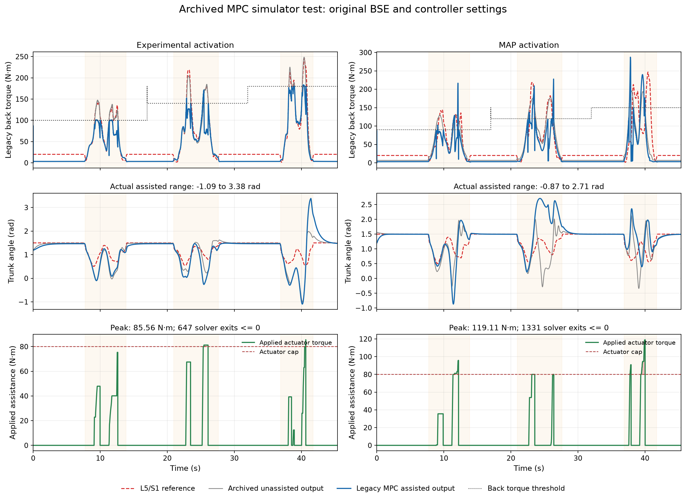
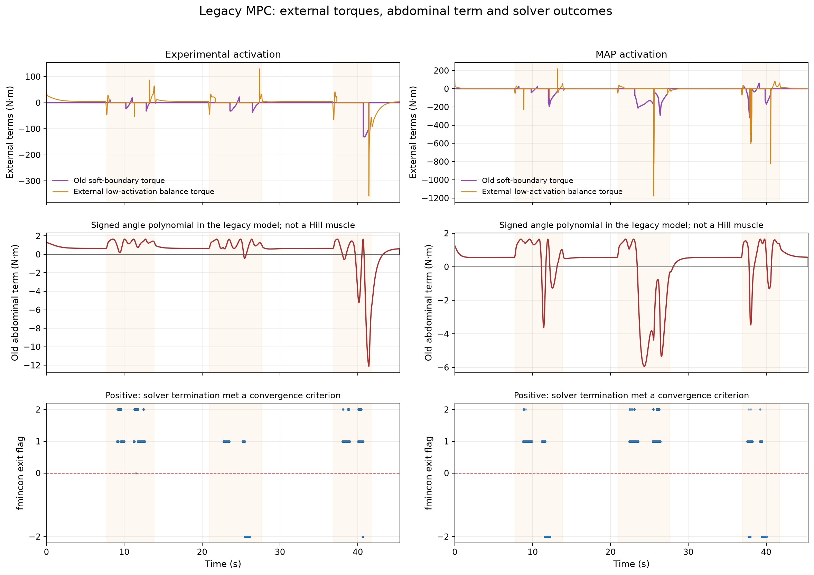

# 原 MPC simulator 回放测试

**该页为修复前的归档结果。当前默认入口已更新为双 Hill / MPC，见 [修复说明与新图](HILL_MPC.zh-CN.md)；重现本页旧分支请运行 `demo_legacy_mpc_archive`。**

实验 activation 与 MAP activation 的原 MPC/BSE 设置都完成了 **45.4 秒、45,401 个采样点**的离线回放，包括原记录中 5、10、15 kg 三段动作及等待间隙。程序执行完成，但两套结果均未达到合理的角度和辅助力矩要求。

这次运行的是原目录 `Simulate the controller with the experimental activation` 与 `Simulate the controller with the MAP activation` 对应的 simulator。它们仍采用原来的单背肌 BSE、腹部角度多项式和外部姿态平衡项，**不是当前选定的双 Hill / neural 模型，也不是其九工况测试**。原来的代码和 MAT 输入保留；测试只在 `prepare_workflow` 生成的独立副本中执行。

## 回放结果

| 实际结果 | 实验 activation | MAP activation |
| --- | ---: | ---: |
| 角度范围，rad | −1.094–3.384 | −0.866–2.707 |
| 全记录相对原角度 reference 的 RMSE，° | 27.41 | 30.15 |
| 背肌力矩峰值，N·m | 183.12 | 287.21 |
| 实际辅助力矩峰值，N·m | **85.56** | **119.11** |
| 预设辅助力矩上限，N·m | 80 | 80 |
| 辅助力矩超过上限的采样点 | 646 | 1330 |
| 旧 soft boundary 力矩绝对峰值，N·m | **131.11** | **318.86** |
| 外部低激活平衡项力矩绝对峰值，N·m | **357.54** | **1177.52** |
| 旧腹部项力矩范围，N·m | −12.113–1.641 | −5.932–1.641 |
| MPC 求解次数 | 5274 | 5658 |
| 非正求解退出状态次数 | **647** | **1331** |
| 单次求解耗时中位数，ms | 5.70 | 5.69 |
| 单次求解耗时 95 分位数，ms | 39.37 | 12.15 |
| 回放耗时，s | 72.59 | 46.11 |

上述误差使用原 `Combination(:,3)` 的角度 reference，没有重新缩放。原 `Theta_Tac0/Torque_Tac0` 为灰色存档无辅助曲线，并非此次独立重新生成的基线。力矩主图沿用旧脚本输出 `R*MTF`，表示背肌肌腱产生的力矩；腹部多项式项另图列出，因此不把它标成新版双 Hill 的净肌肉力矩。



与灰色存档基线相比，实验 activation 的 5/10/15 kg 动作背肌力矩峰值分别降低约 31.6%、16.5%、26.4%，但 15 kg 角度偏离严重。MAP 的三个动作背肌力矩峰值分别增加约 66.1%、28.0%、46.7%。完整分段数值见 [movement_metrics.csv](legacy_mpc_evaluation/movement_metrics.csv)。这些比较仅针对存档基线，不能作为新模型的助力有效性证明。

## 发现的具体问题

1. **失败的优化结果仍然被施加。** 原代码只接收 `du = fmincon(...)`，没有检查 `exitflag`。实验来源第一次明显越过 80 N·m 出现在 25.467 s，MAP 出现在 11.597 s；两次都从 80.000 增到 80.407 N·m，对应求解退出状态 **−2**。之后无效增量继续累积。这是本次实际记录，不是仅从代码推测。
2. **预测中的力矩约束与块展开不一致。** 目标函数用 `repelem(du,n)`，同一个增量重复 10 次，但原线性约束只限制 `sum(du) <= u_max-u0`。例如 `u0=79`、五个增量均为 0.2 时，原约束允许该解，预测展开末端却到 89 N·m。应对展开后的所有预测控制力矩约束，并处理求解失败。这里只指出问题，未在基线测试中改写控制策略。
3. **只允许非负增量，助力关闭时直接归零。** 原 `du` 范围为 0–0.5 N·m，预测无法主动减小辅助力矩；未触发 MPC 时，`Tac(k+1)` 直接设为零。图中可见多次阶梯上升和突然关断。
4. **旧软限位没有饱和上限。** activation 大于 0.05 且 θ 大于 1 rad 时，实验来源实际加入 `−40*(θ−1)−16*ω`，MAP 加入 `−100*(θ−1)−40*ω`，同时包含位置与速度项。后面的 `elseif θ>1.5` 被前面的 `if θ>1` 覆盖，永远不会进入。
5. **旧平衡项直接跟踪存档无辅助角度。** activation 小于 0.05 时，实验来源直接加入 `200*(theta_real−θ)+80*(dtheta_real−ω)`，MAP 使用 500 和 200；其中 `theta_real` 来自 `Theta_Tac0`，并非 `Combination(:,3)` 的实验角度 reference。该门槛也可能在运动过程中触发，因此图中称为“低激活平衡项”。
6. **旧腹部项不是 Hill 肌肉。** 原二次多项式在大角度偏离时变成负值；不能将这次的腹部项解释为已经核实的生理肌肉募集。



这里的旧边界项峰值 131/319 N·m 与当前新模型的边界设置不同。当前双 Hill 模型使用 0.05–1.90 rad 零作用区间和 80 N·m 饱和限位，实际九工况边界力矩为零，见 [当前 soft boundary 图](hill_neural_evaluation/soft_boundary_characteristic.png)。

## 保留的设置与运行修复

保留两套脚本各自的原 14 个 BSE 参数、1 ms 步长、100 样本预测时域、5 个控制块、每块 10 样本、原力矩阈值、Q=12/R=3/W=3、80 N·m 上限及原增量范围。原输入文件与规范目录里的 MAT 文件逐字节一致。

测试副本仅做了如下运行改动：将有限差分计算改为串行；保护 `U(k−1)` 的首帧索引；当预测窗口超出记录末尾时保持最后一个采样值；记录耗时、迭代次数及求解状态；用新的图替代原绘图部分。**本次两来源的首帧都没有触发优化，末 100 点都没有调用预测，两个索引保护实际未改变本次控制轨迹。**

原并行实验来源试跑在 370.7 秒后只报告到 25.55%，停止该测试进程后采用串行完成完整回放。串行运行没有修改 BSE 方程或控制器目标，但本次耗时属于该运行设置，不能宣称为 1 kHz 实时控制的性能。两套实际完整回放都没有非有限状态。

## 如何运行

在 `GitHub_Ready` 根目录打开 MATLAB，运行：

```matlab
demo_legacy_mpc_archive
```

脚本顺序运行两种 activation，保存原始回放及求解诊断，并显示两个对比图。每次建立新的运行副本，不覆盖原实验文件。只重画现有回放可以使用：

```matlab
addpath('experiments/legacy_mpc');
plot_legacy_mpc_results(pwd);
```

完整科学图、分段指标、输入与代码哈希可用项目 Python 环境重新导出：

```text
python experiments/legacy_mpc/evaluate_legacy_mpc.py
```

数值与图保存在 `results/legacy_mpc`，公开报告快照保存在 `docs/legacy_mpc_evaluation`。该测试明确暴露了旧 MPC 的控制边界、外部姿态项和模型募集问题；这些问题需要处理后，才适合进一步连接当前双 Hill 模型进行九工况 MPC 评估。
