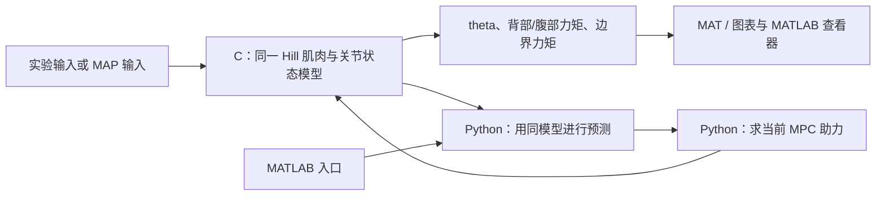

# 当前 BSE / MPC 究竟在哪里运行

**最近优化、训练和展示的双 Hill / MPC 结果，没有通过 Simulink 运行。** 当前使用 MATLAB 入口和查看器、Python 训练/控制逻辑，以及 C 语言的耦合物理求解器。原来的两个 `.slx` 被保留用于历史实现核对，没有自动包含本轮新模型、新参数和新控制器。

## 当前代码的分工

| 部分 | 实际代码 | 负责什么 |
|---|---|---|
| MATLAB 主入口 | `demo_hill_subjects.m` | 默认读取已发布图片；带参数时用 `system` 调用 Python 流程 |
| 新增 Exp 入口 | `demo_exp_subjects.m` | 查看 A=0.1 两组结果，检查状态，仅补齐未完成训练阶段 |
| 已训练的 MAP 预测器 | `predict_exp_activation.m` | 读取个体 MAP 参数，以负载、完整动作 BPM 和相位预测背肌 activation |
| 原 subject 的 MPC 入口 | `demo_hill_mpc.m` | 检查模型回放缓存、调用 Python MPC 和评价脚本，再显示结果 |
| MAP | `experiments/multi_subject/prepare_subjects.py` 的 `fit_map` | 四个 NMF 成分、三 Gaussian 基元、负载/节律到权重的回归 |
| BSE 参数训练 | `experiments/multi_subject/fit_subject.py` | 调用同一 C 模型，用 SciPy 有界最小二乘优化 subject-specific 参数 |
| 肌肉与躯干计算 | `experiments/hill_compliant/hill_neural_core.c`、`hill_sequence_core.c`、`hill_pair_core.c` | 激活动力学、纤维/肌腱平衡、角度相关肌肉几何及关节运动平衡 |
| 助力状态模型 | `experiments/legacy_mpc/hill_mpc_state.c` | 复用上述物理模型，把外骨骼助力放入同一个状态推进过程 |
| MPC | `experiments/legacy_mpc/run_hill_mpc.py` 的 `mpc_command` / `simulate_case` | 在当前状态附近计算预测和灵敏度，优化助力，再推进模型 |
| 参数 / 数值缓存 | `data/processed/`、`results/` | MAT 参数、输入和回放结果；保存为 MAT 不表示通过 Simulink 计算 |
| 本次 Exp 数据检查 | `review_exp_one_cycle.py`、`demo_exp_data_review.m` | 检查并显示每工况一组 M 峰；不表示两组 Exp 已训练 BSE/MPC |

`experiments/legacy_mpc/` 的名称容易引起误会：其中既保留了旧控制器诊断，也放着当前实际使用的 `run_hill_mpc.py` 和 `hill_mpc_state.c`。不能仅按文件夹名字判断整目录都是旧模型。

## 运行关系



Python 通过 `native_library.py` 把 C 源编译为带源内容哈希的 DLL，再用 `ctypes` 调用。MATLAB 单独回放 Hill 系统时，可以调用同源 C 的 MEX，也有 MATLAB 后备实现。这两个接口不等于使用 Simulink 方块模型。

物理求解会随时间推进状态，但**theta 与力矩来自同一套 Hill—肌腱—关节方程**。角度改变肌肉长度，肌腱力决定关节力矩；每个内部时间步联立求解肌肉平衡和关节运动。没有把另一条独立角度拟合曲线塞进结果，也没有通过 reference 连续强行指定角度。

在已发布的 MPC 回放中，输入采样为 100 Hz，实际物理内部步长通常为 1 ms；MPC 每 20 ms 更新一次，预测通常为 16 × 25 ms，共 0.4 s，分为 4 个控制块。Python 对当前控制序列做局部线性化/二次近似，用 SciPy SLSQP 解带幅值、变化率和可达性松弛的优化，再应用第一个指令。它使用了非线性 Hill 预测，但不是直接调用原 Simulink 的 Nonlinear MPC Controller 方块。

记录的 reference 角度/力矩用于训练、评价及初始化所需状态；控制时的姿态保持目标来自同一人体模型的未助力预测。站立神经调节改变肌肉激励，软限位则是单列输出的边界力矩。这些是模型假设和数值实现，不等于已经建立电机、驱动器、通信延迟和完整外骨骼连杆的硬件模型。

## 保留的两个 Simulink 模型

| 文件 | 已核对的内容 | 与当前结果的关系 |
|---|---|---|
| `models/training_bse/dynamic_function.slx` | 14 个方块，包括两个 Integrator、From Workspace、余弦、增益和求和 | 原始 BSE/动力学实现，保留供复现比较 |
| `models/control_experimental/NMPC_controller.slx` | 35 个方块，包括 MATLAB Function、MEP predictor 和 Nonlinear MPC Controller 引用块 | 原始控制实现，保留供复现比较 |

这些统计通过读取 SLX 内部 XML 获得。本轮没有用这两个 `.slx` 生成最新优化图，也没有把新 C/Python 模型自动同步到它们。直接打开旧 `.slx` 时，不能把其中的参数和输出当作当前新版。

## 现在怎样查看

MATLAB 切换到项目根目录：

```matlab
demo_exp_data_review;              % New Exp data inspection only.
demo_hill_subjects;                % Published, previously calibrated subjects.
demo_hill_subjects('threshold-replay'); % Recompute their saved latest MPC.
```

`demo_hill_subjects` 默认只看图，不会自动重新训练；原 subject 的 `demo_hill_mpc` 会运行 Python 控制回放。两组新 Exp 当前的 M 峰图属于数据审查结果，不能当作已经完成的新 subject 的 BSE/MPC 结果。
